# Схема данных (ER) — миграция v1

Источник правды — модели SQLAlchemy (`backend/app/*/models.py`), миграция
`backend/alembic/versions/0001_initial_schema.py`. Диаграмма ниже собрана из metadata моделей.

## Таблицы по модулям

| Модуль | Таблицы |
|---|---|
| users | `users`, `roles`, `consents` |
| auth | `email_tokens` (подтверждение почты 24 ч, сброс пароля) |
| catalog | `specializations`, `grades`, `categories`, `topics`, `skills`, `skill_specializations`, `platform_settings` |
| candidates | `candidate_profiles`, `candidate_skills`, `resumes` |
| companies | `companies`, `recruiters` |
| matching | `needs` (потребности работодателя) |
| testing | `items` (шаблоны задач), `item_params_log`, `test_sessions`, `test_answers`, `grade_history` |
| fsp | `fsp_links`, `fsp_achievements` (кэш реестра) |
| invitations | `invitations`, `invitation_events` |
| vacancies | `vacancies`, `applications` |
| tasks | `regular_tasks`, `task_submissions` |
| admin | `audit_log`, `reports` (жалобы) |

## Решения

- Коды справочников (`backend`, `middle`, `backend:middle`, роли) — строковые первичные ключи.
  Роли, специализации, грейды и 24 категории вставляет сама миграция; темы, стек и демо-данные —
  сид из `data/seed` (волна 2).
- Статусы и типы хранятся строками (`VARCHAR`), допустимые значения — enum'ы в `app/common/enums.py`.
  Так проще менять набор значений без миграций типов PostgreSQL.
- Зарплата: в `needs`, `vacancies`, `invitations` — CHECK `salary_from > 0 AND salary_from <= salary_to`.
- `candidate_profiles.min_salary` видна только системе: в API рекрутера её нет.
- Контакты кандидата лежат в `users` (почта, ФИО) и `candidate_profiles` (телефон, telegram);
  раскрытие рекрутеру решает сервис по `invitations.status = accepted` или наличию `applications`.
- Время ответа на задачу считает сервер: `test_answers.shown_at` / `answered_at`.
- `test_sessions.engine_state` (JSONB) — состояние адаптивного движка (трек 0b).
- `needs.saved_filters` — уточнения подборки без потери исходного списка (T6.4).

## Диаграмма

```mermaid
erDiagram
    companies {
        BIGINT id PK
        VARCHAR name
        TEXT description
        VARCHAR industry
        VARCHAR website
        VARCHAR city
        VARCHAR contact_email
        VARCHAR contact_phone
        VARCHAR inn
        BOOLEAN verified_domain
        FLOAT trust_score
        BOOLEAN blocked
        VARCHAR invite_code UK
        TIMESTAMP_WITH_TIME_ZONE created_at
    }
    fsp_achievements {
        BIGINT id PK
        VARCHAR fsp_id
        VARCHAR external_id
        VARCHAR competition
        VARCHAR discipline
        VARCHAR level
        DATE date
        INTEGER place
        VARCHAR diploma
        VARCHAR team
        VARCHAR role
        FLOAT rating
        VARCHAR protocol_url
        BOOLEAN verified
        TIMESTAMP_WITH_TIME_ZONE synced_at
    }
    grades {
        VARCHAR code PK
        VARCHAR label
        INTEGER order UK
    }
    platform_settings {
        VARCHAR key PK
        JSONB value
        TIMESTAMP_WITH_TIME_ZONE updated_at
    }
    roles {
        VARCHAR code PK
        VARCHAR label
    }
    skills {
        VARCHAR code PK
        VARCHAR label
    }
    specializations {
        VARCHAR code PK
        VARCHAR label
        TEXT description
        BOOLEAN active
    }
    categories {
        VARCHAR code PK
        VARCHAR specialization FK
        VARCHAR grade FK
        VARCHAR label
    }
    skill_specializations {
        VARCHAR skill_code PK,FK
        VARCHAR specialization PK,FK
    }
    topics {
        VARCHAR code PK
        VARCHAR specialization FK
        VARCHAR label
    }
    users {
        BIGINT id PK
        VARCHAR email UK
        VARCHAR password_hash
        VARCHAR role FK
        VARCHAR full_name
        BOOLEAN email_verified
        BOOLEAN blocked
        INTEGER failed_login_attempts
        TIMESTAMP_WITH_TIME_ZONE locked_until
        TIMESTAMP_WITH_TIME_ZONE last_login_at
        TIMESTAMP_WITH_TIME_ZONE created_at
    }
    audit_log {
        BIGINT id PK
        TIMESTAMP_WITH_TIME_ZONE at
        BIGINT actor_user_id FK
        VARCHAR actor_role
        VARCHAR action
        VARCHAR target_type
        BIGINT target_id
        TEXT summary
        JSONB details
    }
    candidate_profiles {
        BIGINT id PK
        BIGINT user_id FK,UK
        VARCHAR pseudonym UK
        VARCHAR phone
        VARCHAR telegram
        VARCHAR city
        TEXT_ARRAY work_formats
        VARCHAR specialization FK
        VARCHAR grade FK
        VARCHAR category FK
        FLOAT theta
        FLOAT theta_se
        JSONB topic_scores
        TEXT_ARRAY roles_in_team
        FLOAT experience_years
        TEXT_ARRAY soft_skills
        TEXT about
        JSONB links
        INTEGER min_salary
        JSONB privacy
        BOOLEAN job_search_paused
        FLOAT freshness
        TIMESTAMP_WITH_TIME_ZONE last_test_at
        TIMESTAMP_WITH_TIME_ZONE grade_changed_at
        TIMESTAMP_WITH_TIME_ZONE updated_at
        TIMESTAMP_WITH_TIME_ZONE created_at
    }
    consents {
        BIGINT id PK
        BIGINT user_id FK
        VARCHAR type
        VARCHAR version
        BOOLEAN granted
        TIMESTAMP_WITH_TIME_ZONE granted_at
        TIMESTAMP_WITH_TIME_ZONE revoked_at
    }
    email_tokens {
        BIGINT id PK
        BIGINT user_id FK
        VARCHAR purpose
        VARCHAR token_hash UK
        TIMESTAMP_WITH_TIME_ZONE expires_at
        TIMESTAMP_WITH_TIME_ZONE used_at
        TIMESTAMP_WITH_TIME_ZONE created_at
    }
    items {
        BIGINT id PK
        VARCHAR code UK
        VARCHAR title
        TEXT description
        VARCHAR specialization FK
        VARCHAR topic FK
        VARCHAR target_grade FK
        VARCHAR format
        VARCHAR generator
        JSONB generator_params
        FLOAT a
        FLOAT b
        VARCHAR status
        VARCHAR source
        INTEGER exposures
        INTEGER correct_count
        BOOLEAN leak_flag
        FLOAT leak_score
        TIMESTAMP_WITH_TIME_ZONE created_at
    }
    recruiters {
        BIGINT id PK
        BIGINT user_id FK,UK
        BIGINT company_id FK
        VARCHAR position
        VARCHAR phone
        VARCHAR telegram
        BOOLEAN is_company_admin
    }
    vacancies {
        BIGINT id PK
        BIGINT company_id FK
        VARCHAR title
        TEXT description
        VARCHAR specialization FK
        VARCHAR grade FK
        VARCHAR category FK
        TEXT_ARRAY skills_required
        TEXT_ARRAY skills_desired
        VARCHAR work_format
        VARCHAR city
        INTEGER salary_from
        INTEGER salary_to
        VARCHAR status
        TIMESTAMP_WITH_TIME_ZONE published_at
        TIMESTAMP_WITH_TIME_ZONE created_at
    }
    applications {
        BIGINT id PK
        BIGINT vacancy_id FK
        BIGINT candidate_id FK
        TEXT cover_letter
        VARCHAR status
        TIMESTAMP_WITH_TIME_ZONE updated_at
        TIMESTAMP_WITH_TIME_ZONE created_at
    }
    candidate_skills {
        BIGINT candidate_id PK,FK
        VARCHAR skill_code PK,FK
    }
    fsp_links {
        BIGINT id PK
        BIGINT candidate_id FK,UK
        VARCHAR fsp_id UK
        VARCHAR keycloak_sub
        TIMESTAMP_WITH_TIME_ZONE linked_at
        TIMESTAMP_WITH_TIME_ZONE last_sync_at
    }
    item_params_log {
        BIGINT id PK
        BIGINT item_id FK
        FLOAT a_before
        FLOAT a_after
        FLOAT b_before
        FLOAT b_after
        INTEGER responses_count
        VARCHAR reason
        TIMESTAMP_WITH_TIME_ZONE created_at
    }
    needs {
        BIGINT id PK
        BIGINT company_id FK
        BIGINT recruiter_id FK
        VARCHAR title
        TEXT raw_text
        VARCHAR specialization FK
        VARCHAR grade FK
        VARCHAR category FK
        TEXT_ARRAY skills_required
        TEXT_ARRAY skills_desired
        TEXT team_description
        VARCHAR work_format
        VARCHAR city
        INTEGER salary_from
        INTEGER salary_to
        VARCHAR status
        JSONB saved_filters
        TIMESTAMP_WITH_TIME_ZONE created_at
    }
    regular_tasks {
        BIGINT id PK
        BIGINT company_id FK
        BIGINT recruiter_id FK
        VARCHAR title
        TEXT statement
        VARCHAR category FK
        INTEGER deadline_days
        VARCHAR status
        TIMESTAMP_WITH_TIME_ZONE created_at
    }
    resumes {
        BIGINT id PK
        BIGINT candidate_id FK
        VARCHAR filename
        VARCHAR storage_path
        VARCHAR parser
        JSONB parsed
        TIMESTAMP_WITH_TIME_ZONE created_at
    }
    test_sessions {
        BIGINT id PK
        BIGINT candidate_id FK
        VARCHAR specialization FK
        VARCHAR target_grade FK
        VARCHAR kind
        VARCHAR status
        TIMESTAMP_WITH_TIME_ZONE started_at
        TIMESTAMP_WITH_TIME_ZONE finished_at
        INTEGER items_answered
        INTEGER max_items
        FLOAT theta
        FLOAT se
        VARCHAR result_grade FK
        BOOLEAN passed
        JSONB topic_scores
        JSONB engine_state
    }
    grade_history {
        BIGINT id PK
        BIGINT candidate_id FK
        TIMESTAMP_WITH_TIME_ZONE at
        VARCHAR event
        VARCHAR specialization FK
        VARCHAR grade_from FK
        VARCHAR grade_to FK
        BIGINT test_session_id FK
        TEXT comment
    }
    invitations {
        BIGINT id PK
        BIGINT candidate_id FK
        BIGINT recruiter_id FK
        BIGINT company_id FK
        BIGINT need_id FK
        BIGINT vacancy_id FK
        VARCHAR category FK
        TEXT description
        INTEGER salary_from
        INTEGER salary_to
        VARCHAR contact_type
        VARCHAR contact_value
        TEXT task_text
        VARCHAR status
        VARCHAR decline_reason
        TEXT decline_comment
        TIMESTAMP_WITH_TIME_ZONE viewed_at
        TIMESTAMP_WITH_TIME_ZONE responded_at
        TIMESTAMP_WITH_TIME_ZONE expires_at
        TIMESTAMP_WITH_TIME_ZONE withdrawn_at
        TIMESTAMP_WITH_TIME_ZONE created_at
    }
    task_submissions {
        BIGINT id PK
        BIGINT task_id FK
        BIGINT candidate_id FK
        VARCHAR status
        TIMESTAMP_WITH_TIME_ZONE assigned_at
        TIMESTAMP_WITH_TIME_ZONE due_at
        VARCHAR answer_kind
        TEXT answer_text
        TIMESTAMP_WITH_TIME_ZONE submitted_at
        INTEGER score
        TEXT grader_comment
        BIGINT graded_by FK
        TIMESTAMP_WITH_TIME_ZONE graded_at
    }
    test_answers {
        BIGINT id PK
        BIGINT session_id FK
        BIGINT item_id FK
        BIGINT seed
        INTEGER position
        TIMESTAMP_WITH_TIME_ZONE shown_at
        TIMESTAMP_WITH_TIME_ZONE answered_at
        JSONB answer
        BOOLEAN correct
        INTEGER response_time_ms
        BOOLEAN is_scored
        FLOAT theta_after
        FLOAT se_after
    }
    invitation_events {
        BIGINT id PK
        BIGINT invitation_id FK
        VARCHAR type
        TIMESTAMP_WITH_TIME_ZONE at
        BIGINT actor_user_id FK
        VARCHAR actor_role
    }
    reports {
        BIGINT id PK
        BIGINT company_id FK
        BIGINT reporter_candidate_id FK
        BIGINT invitation_id FK
        BIGINT vacancy_id FK
        VARCHAR reason
        TEXT text
        VARCHAR status
        TEXT resolution
        BIGINT resolved_by FK
        TIMESTAMP_WITH_TIME_ZONE resolved_at
        TIMESTAMP_WITH_TIME_ZONE created_at
    }

    candidate_profiles ||--o{ applications : "candidate_id"
    candidate_profiles ||--o{ candidate_skills : "candidate_id"
    candidate_profiles ||--o{ grade_history : "candidate_id"
    candidate_profiles ||--o{ invitations : "candidate_id"
    candidate_profiles ||--o{ reports : "reporter_candidate_id"
    candidate_profiles ||--o{ resumes : "candidate_id"
    candidate_profiles ||--o{ task_submissions : "candidate_id"
    candidate_profiles ||--o{ test_sessions : "candidate_id"
    candidate_profiles ||--o| fsp_links : "candidate_id"
    categories |o--o{ candidate_profiles : "category"
    categories ||--o{ invitations : "category"
    categories ||--o{ needs : "category"
    categories ||--o{ regular_tasks : "category"
    categories ||--o{ vacancies : "category"
    companies ||--o{ invitations : "company_id"
    companies ||--o{ needs : "company_id"
    companies ||--o{ recruiters : "company_id"
    companies ||--o{ regular_tasks : "company_id"
    companies ||--o{ reports : "company_id"
    companies ||--o{ vacancies : "company_id"
    grades |o--o{ candidate_profiles : "grade"
    grades |o--o{ grade_history : "grade_from"
    grades |o--o{ grade_history : "grade_to"
    grades |o--o{ test_sessions : "result_grade"
    grades ||--o{ categories : "grade"
    grades ||--o{ items : "target_grade"
    grades ||--o{ needs : "grade"
    grades ||--o{ test_sessions : "target_grade"
    grades ||--o{ vacancies : "grade"
    invitations |o--o{ reports : "invitation_id"
    invitations ||--o{ invitation_events : "invitation_id"
    items ||--o{ item_params_log : "item_id"
    items ||--o{ test_answers : "item_id"
    needs |o--o{ invitations : "need_id"
    recruiters ||--o{ invitations : "recruiter_id"
    recruiters ||--o{ needs : "recruiter_id"
    recruiters ||--o{ regular_tasks : "recruiter_id"
    regular_tasks ||--o{ task_submissions : "task_id"
    roles ||--o{ users : "role"
    skills ||--o{ candidate_skills : "skill_code"
    skills ||--o{ skill_specializations : "skill_code"
    specializations |o--o{ candidate_profiles : "specialization"
    specializations |o--o{ grade_history : "specialization"
    specializations ||--o{ categories : "specialization"
    specializations ||--o{ items : "specialization"
    specializations ||--o{ needs : "specialization"
    specializations ||--o{ skill_specializations : "specialization"
    specializations ||--o{ test_sessions : "specialization"
    specializations ||--o{ topics : "specialization"
    specializations ||--o{ vacancies : "specialization"
    test_sessions |o--o{ grade_history : "test_session_id"
    test_sessions ||--o{ test_answers : "session_id"
    topics ||--o{ items : "topic"
    users |o--o{ audit_log : "actor_user_id"
    users |o--o{ invitation_events : "actor_user_id"
    users |o--o{ reports : "resolved_by"
    users |o--o{ task_submissions : "graded_by"
    users ||--o{ consents : "user_id"
    users ||--o{ email_tokens : "user_id"
    users ||--o| candidate_profiles : "user_id"
    users ||--o| recruiters : "user_id"
    vacancies |o--o{ invitations : "vacancy_id"
    vacancies |o--o{ reports : "vacancy_id"
    vacancies ||--o{ applications : "vacancy_id"
```

