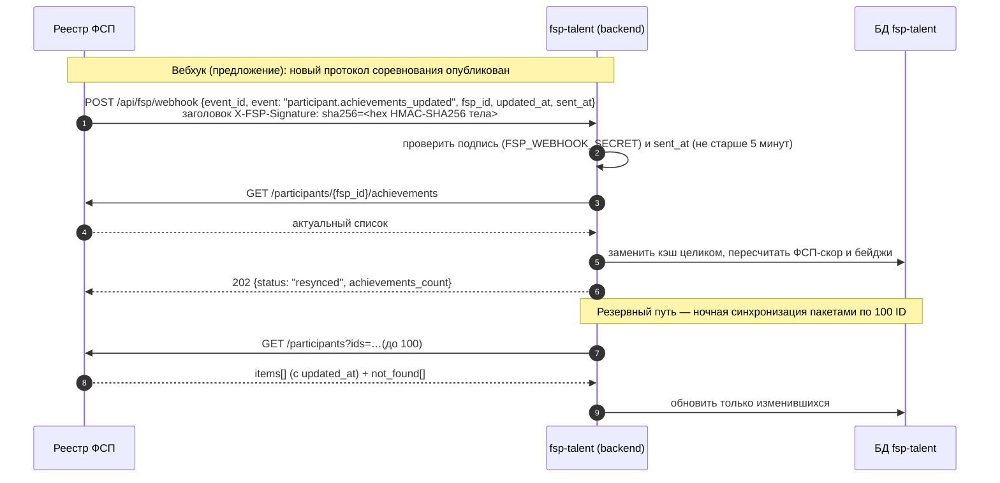

# Интеграция с ФСП: ФСП ID и реестр достижений

Черновик схемы для жюри и для будущей интеграции с Федерацией спортивного программирования.
Организаторы намеренно не дали ни API, ни структуру данных ФСП [ТЗ 2, 4]. Поэтому здесь
описано, **какие данные мы предлагаем получать и как**. На хакатоне обе части ФСП работают
у нас локально:

| Часть | В реальности | У нас на хакатоне |
|---|---|---|
| ФСП ID (вход и подтверждение личности) | Keycloak ФСП | Keycloak 25, realm `fsp` — `infra/keycloak/realm-fsp.json` |
| Реестр достижений | API реестра ФСП (его пока нет) | мок `services/fsp-registry-mock` — это и есть наш вариант контракта API |
| Платформа fsp-talent | — | backend, модуль `fsp`, таблицы `fsp_links`, `fsp_achievements` (кэш) |

Все данные в моке синтетические: люди, команды, соревнования, места и рейтинги выдуманы.

## 1. Что получаем и зачем

Работодателю важно не «участвовал ли человек в ФСП», а **что это говорит о навыках**:

- **дисциплина** — продуктовое, алгоритмическое программирование, программирование систем ИБ,
  БАС, робототехники. По ней видно, к какой работе близок опыт;
- **уровень** — региональный, всероссийский, международный;
- **результат** — место, диплом I/II/III степени или участие; плюс размер зачёта
  («12 место из 300» и «12 место из 15» — разные вещи);
- **дата** — свежий результат весит больше старого;
- **командное или личное** участие и **роль в команде** (бэкенд, ML, капитан и т.п.) —
  это прямой сигнал для работодателя о роли кандидата;
- **ссылка на протокол** — чтобы любой мог проверить результат в первоисточнике;
- **рейтинг-очки** реестра — если у ФСП есть свой рейтинг, берём его как есть.

Чего **не** берём: дату рождения, контакты, документы, школу/вуз. Платформе это не нужно
для подбора (принцип минимизации данных, 152-ФЗ). ФИО и регион берём только для сверки
с профилем кандидата, работодателю они до принятия приглашения не показываются.

## 2. Вход и привязка через ФСП ID (OIDC)

Основной вход в fsp-talent — свой (почта + пароль). ФСП ID нужен для двух вещей:
**«Войти через ФСП ID»** и **«Привязать ФСП ID»** в настройках профиля [ТЗ 2, 3.5].

Протокол — OpenID Connect, Authorization Code + PKCE (S256). Клиент `fsp-talent` публичный
(без секрета), поэтому PKCE обязателен — Keycloak отклоняет запрос без `code_challenge`.
Номер участника приходит в токене в отдельном claim **`fsp_id`** (атрибут пользователя
Keycloak + protocol mapper; есть и в ID-токене, и в access-токене, и в userinfo).

```mermaid
sequenceDiagram
    autonumber
    actor C as Кандидат
    participant F as fsp-talent (фронт)
    participant B as fsp-talent (backend)
    participant K as ФСП ID (Keycloak)
    participant R as Реестр ФСП (API)

    C->>F: «Привязать ФСП ID»
    F->>B: начать привязку
    B-->>F: адрес входа Keycloak (state, nonce, code_challenge S256)
    F->>K: /realms/fsp/protocol/openid-connect/auth
    K->>C: страница входа ФСП ID
    C->>K: логин и пароль ФСП
    K-->>F: redirect_uri?code=...&state=...
    F->>B: code + state
    B->>K: /token (code + code_verifier)
    K-->>B: id_token (claim fsp_id), access_token
    B->>B: проверка подписи (JWKS), iss, aud, nonce; fsp_id ещё ни к кому не привязан
    B->>R: GET /participants/{fsp_id}
    R-->>B: профиль и сводка
    B->>R: GET /participants/{fsp_id}/achievements
    R-->>B: достижения (или пустой список)
    B->>B: сохранить fsp_links + кэш fsp_achievements, пересчитать ФСП-скор
    B-->>F: ФСП ID привязан, N достижений
    F-->>C: бейджи «подтверждено ФСП» в профиле
```

Правила привязки:

- один `fsp_id` — один профиль на платформе (повторная привязка к другому аккаунту — ошибка
  `409 fsp_id_taken`; если к профилю уже привязан другой ФСП ID — `409 fsp_already_linked`);
- **отвязка** удаляет связь и кэш достижений, ФСП-скор становится «нет данных»;
- «Войти через ФСП ID» работает только для уже привязанного профиля; если связи нет —
  предлагаем войти обычным способом и привязать;
- если Keycloak недоступен, основной вход по почте работает как обычно, кнопка ФСП ID
  показывает «Сервис ФСП ID временно недоступен».

## 3. Контракт API реестра (наш мок)

Сервис `services/fsp-registry-mock`, Swagger — `http://localhost:18100/docs`.

| Метод | Что отдаёт |
|---|---|
| `GET /health` | `{"status": "ok", "participants": 40, "synthetic": true}` |
| `GET /participants/{fsp_id}` | ФИО, регион, дата регистрации в ФСП, `has_history`, сводка (`summary`) |
| `GET /participants/{fsp_id}/achievements` | `{fsp_id, has_history, total, items[], updated_at}`; фильтры `discipline`, `level` |
| `GET /participants?ids=FSP-000001,FSP-000002` | пакетно до 100 ID: `{items[], not_found[]}` — для ночной синхронизации |
| `GET /dictionaries` | справочники дисциплин и уровней с подписями |

Коды дисциплин реестра `security` и `uav` платформа при синхронизации переводит в свои
`cybersecurity` и `uas` (`DISCIPLINE_FROM_REGISTRY` в `backend/app/fsp/service.py`);
остальные коды совпадают.

Ошибки — в общем формате платформы: `{"code", "message", "details"}`.
`404 participant_not_found` — такого ID нет; `422 invalid_fsp_id` — неверный формат.
Участник **без истории — не ошибка**: `200`, `has_history: false`, `items: []`.

Пример достижения:

```json
{
  "id": "ACH-000001-05",
  "competition": {
    "id": "COMP-2025-05",
    "title": "Международный онлайн-хакатон по продуктовому программированию",
    "organizer": "ФСП России и партнёры (международный зачёт)",
    "region": null,
    "participants_total": 260,
    "protocol_url": "https://registry.fsp.example/protocols/COMP-2025-05.pdf"
  },
  "discipline": {"code": "product", "title": "Продуктовое программирование"},
  "level": {"code": "international", "title": "Международный"},
  "date": "2025-09-13",
  "result": {"kind": "place", "place": 1, "diploma_degree": null, "label": "1 место"},
  "participation": "team",
  "team": {"name": "Северные лисы", "size": 5, "role": "фулстек-разработчик", "is_captain": false},
  "rating_points": 400,
  "verified": true
}
```

Тестовые данные: `FSP-000001`–`FSP-000030` — с достижениями (от 1 до 8),
`FSP-000031`–`FSP-000040` — без истории, остальные ID — 404.

Доступ: в реальной интеграции платформа ходит в реестр как **сервис** — токен Keycloak
по client credentials (отдельный конфиденциальный клиент). В моке это включается
переменной `FSP_MOCK_API_TOKEN`: тогда все методы, кроме `/health`, требуют
`Authorization: Bearer <токен>`. По умолчанию выключено.

## 4. Обновление данных

Достижения меняются редко (несколько раз в год у активного участника), поэтому храним кэш
и обновляем его тремя способами:

1. **При привязке** — сразу, синхронно (кандидат видит бейджи через секунду).
2. **По расписанию** — раз в сутки ночью: берём все привязанные `fsp_id`, запрашиваем
   пакетами по 100 через `GET /participants?ids=...`; если `updated_at` участника новее
   нашего — перезапрашиваем его достижения. `not_found` → помечаем связь как «участник не
   найден в реестре», бейджи скрываем, кандидату пишем уведомление.
3. **Вебхук от ФСП** (предложение для реальной интеграции) — реестр сам сообщает об
   изменении, чтобы не ждать ночи.



Если реестр недоступен — показываем кэш с подписью «данные ФСП на ДД.ММ.ГГГГ», ничего
не удаляем, повторяем позже. Поиск, ранжирование и PDF работают на кэше.

## 5. Если истории ФСП нет

Это обязательный случай [ТЗ 2]. Три варианта, все обрабатываем одинаково мягко:

| Ситуация | Что видит кандидат | Что видит работодатель | Ранжирование |
|---|---|---|---|
| ФСП ID не привязан | «Привяжите ФСП ID — достижения подтянутся автоматически» | «Нет данных ФСП» (нейтрально, серым) | ФСП-скор не участвует, штрафа нет |
| Привязан, истории нет (`has_history: false`) | «В реестре ФСП пока нет результатов» + ссылка на календарь соревнований | «Нет данных ФСП» | то же |
| Реестр недоступен | кэш с датой | кэш с датой | по кэшу |

Главное правило: **отсутствие истории не штраф**. Кандидат без ФСП получает 0 бонуса,
но не минус: его место в выдаче определяется тестом, стеком, зарплатой и форматом.
Формулировка «нет данных», а не «нет достижений» — чтобы не выглядело как недостаток.

## 6. Что показываем работодателю

До принятия приглашения профиль обезличен (ФИО и контакты скрыты), но достижения ФСП
видны — это и есть «подтверждённый профиль» [ТЗ 2.1]:

- бейджи: «Призёр всероссийских соревнований», «Победитель международного зачёта»,
  «Участник 5 соревнований ФСП», «Капитан команды» — с пометкой **«подтверждено ФСП»**;
- список результатов: дисциплина, уровень, результат («2 место из 120»), год, роль в команде;
- ФСП-скор 0–100 полоской в разбивке счёта и одна строка в «почему в подборке»
  («призёр всероссийского хакатона по продуктовому программированию, 2026»);
- ссылка на протокол — чтобы проверить первоисточник.

Не показываем до принятия: ФИО, регион, название команды (по нему легко найти человека),
точные даты (только год). Кандидат может скрыть блок ФСП в настройках приватности (T3.4).

## 7. ФСП-скор

Одно число 0–100, которое входит в ранжирование внутри категории (T6.3) и объясняется
кандидату и работодателю.

```
S = Σ по достижениям  L(уровень) × R(результат) × F(возраст)
ФСП-скор = round(100 × (1 − e^(−S / 3)))
```

| Множитель | Значения |
|---|---|
| **L — уровень** | региональный 1; всероссийский 2; международный 3 |
| **R — результат** | 1 место 1,0; 2 место 0,85; 3 место 0,7; диплом I 0,8; диплом II 0,6; диплом III 0,45; 4–10 место 0,4; ниже 10-го 0,25; участие 0,1 |
| **F — свежесть** | 0,5^(возраст в годах / 2) — результат «стареет» вдвое за 2 года |

Почему так:

- **сумма с насыщением** (`1 − e^(−S/3)`): много слабых участий не обгоняют одну победу,
  а десятая победа добавляет меньше первой — скор не «накручивается» количеством;
- **свежесть**: навыки трёхлетней давности — слабый сигнал для работодателя;
- **участие тоже считается** (0,1), но мало: факт участия — уже плюс, но не главный.

Примеры на данных мока (на 06.10.2026):

| Участник | Достижения | S | ФСП-скор |
|---|---|---|---|
| FSP-000001 | 7, в т.ч. 1 место международного зачёта (2025) и диплом I всероссийского (2026) | 5,88 | 86 |
| FSP-000005 | 3, лучший — диплом III всероссийского (2025) | 0,82 | 24 |
| FSP-000007 | 1, 43 место из 48 на региональном (2025) | 0,14 | 5 |
| FSP-000031 | нет истории | — | «нет данных» |

Развитие после хакатона: множитель релевантности дисциплины специализации (например,
«ИБ» сильнее для DevOps, «алгоритмическое» — для Backend и Data/ML) и учёт роли в команде.
Веса вынесены в конфиг, админ может их менять (T10.3).

## 8. Безопасность и 152-ФЗ

- Токен ФСП ID проверяется на backend: подпись по JWKS realm, `iss`, `aud`/`azp`, срок, `nonce`;
  `state` защищает от CSRF, PKCE — от перехвата кода.
- Привязка ФСП ID — с отдельного согласия кандидата «получать мои результаты из реестра ФСП».
  Отзыв согласия = отвязка и удаление кэша.
- Из реестра храним только поля из раздела 1. Каждое обращение к реестру пишется в журнал.
- Вебхук принимается только с верной HMAC-подписью (`X-FSP-Signature: sha256=<hex>`).
  Отдельной идемпотентности по `event_id` нет и она не нужна: повтор события безопасен —
  синхронизация заменяет кэш участника целиком, дублей не бывает.

## 9. Учебный стенд

Keycloak: `http://localhost:18180`, realm `fsp`, админка — `admin` / пароль из `.env`.

| Логин | ФСП ID | История |
|---|---|---|
| `fsp.user01` … `fsp.user05` | `FSP-000001` … `FSP-000005` | есть |
| `fsp.nohistory` | `FSP-000031` | нет |

Пароль у всех тестовых участников: **`Fsp-demo-2026`** (учебный стенд, не секрет).

Клиенты: `fsp-talent` — для приложения (только Authorization Code + PKCE);
`fsp-talent-test` — **только для автотестов**: разрешает получить токен по логину и паролю
(Direct Access Grants), в проде его быть не должно. Подробнее — `infra/keycloak/README.md`.
