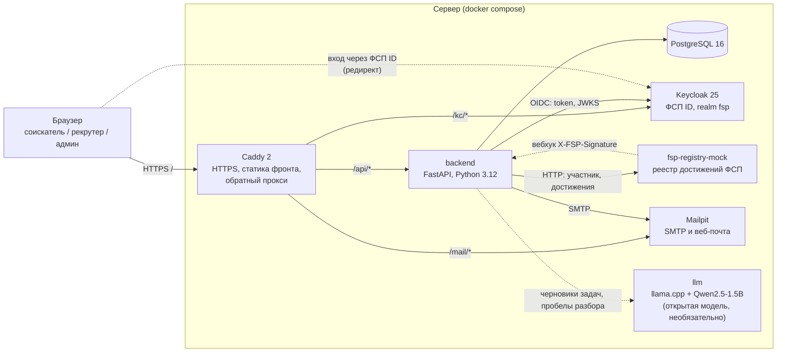
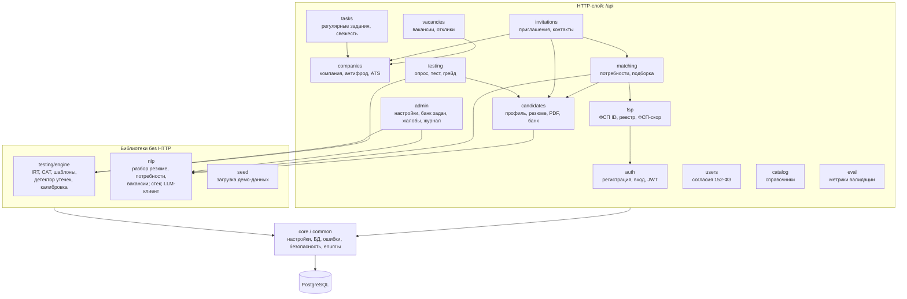
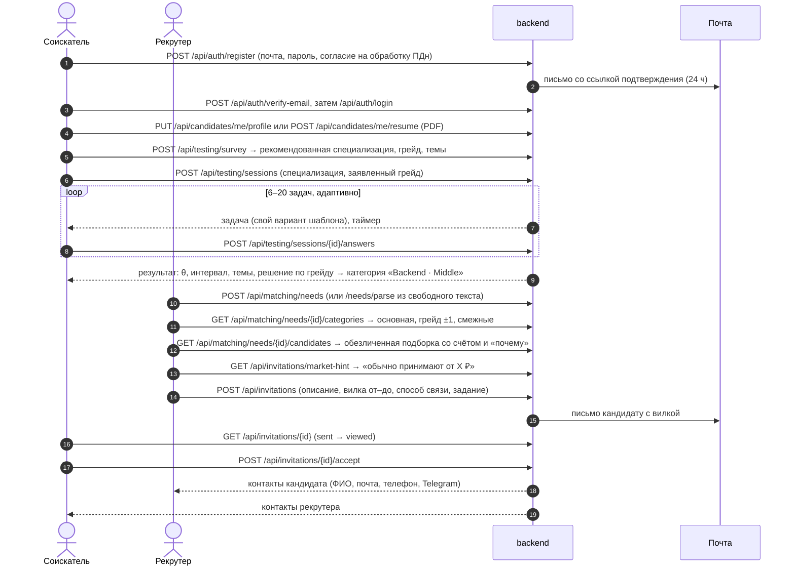

# 1. Функциональная и компонентная архитектура

## 1.1. Что делает система

fsp-talent — веб-платформа подбора IT-специалистов с **обратной механикой**: не кандидат
откликается на вакансии, а работодатель находит нужную **категорию** кандидатов и сам
приглашает конкретного человека, сразу указывая зарплатную вилку.

Категория = **специализация × грейд** (6 × 4 = 24 категории, например «Backend · Middle»).
Её определяет не резюме, а обязательный путь кандидата: опрос по специализации → выбор
предполагаемого грейда → адаптивный тест. Внутри категории кандидаты ранжируются по силе
подтверждённого профиля: результат теста, стек, достижения ФСП, свежесть профиля, зарплата,
формат работы — с объяснением «почему в подборке».

## 1.2. Роли и кабинеты

| Роль | Код | Кто это | Главное в кабинете |
|---|---|---|---|
| Соискатель | `candidate` | участник рынка, ищет работу | профиль и PDF-резюме, опрос и тест, категория и грейд, приглашения (принять / отклонить с причиной), вакансии и отклики, регулярные задания, достижения ФСП, приватность и согласия |
| Рекрутер | `recruiter` | представитель компании | профиль компании, потребности (форма или свободный текст), подборка по категориям с объяснением, банк кандидатов с фильтрами, приглашения со статусами и квотой, вакансии и отклики, регулярные задания |
| Администратор | `admin` | оператор платформы (ФСП) | дашборд, пользователи и компании (блокировка, скоринг надёжности), справочники и настройки (пороги θ, кулдауны, квота, веса ранжирования), банк задач (метрики, утечки, калибровка), тесты из вакансий, валидация, жалобы, журнал действий |

Роль администратора в ТЗ не названа — она нужна для банка задач, детектора утечек,
настроек ранжирования и метрик валидации.

Права проверяются на бэкенде в каждом методе (зависимости `CandidateUser`, `RecruiterUser`,
`AdminUser` в `backend/app/core/security.py`): без входа — `401`, чужая роль — `403`,
чужой объект — `404` (кандидат видит только свои приглашения и отклики, рекрутер — только
записи своей компании). Таблица методов по ролям — [приложение к разделу 6](api_endpoints.md).

## 1.3. Контейнеры (развёртывание)

| Контейнер | Образ | Назначение | Порт в dev-стеке |
|---|---|---|---|
| `frontend` | собственный (node:22-alpine) | React SPA; в dev — Vite, на стенде — статика за Caddy | 15173 |
| `backend` | собственный (python:3.12-slim) | REST API, бизнес-логика, движок теста | 18000 |
| `postgres` | postgres:16-alpine | хранение всех данных | 15432 |
| `keycloak` | quay.io/keycloak/keycloak:25.0 | ФСП ID: вход и привязка профиля (OIDC + PKCE) | 18180 |
| `fsp-registry-mock` | собственный (python:3.12-slim) | наш вариант API реестра достижений ФСП | 18100 |
| `mailpit` | axllent/mailpit | письма подтверждения почты, приглашений, сброса пароля | 18025 (UI), 11025 (SMTP) |
| `llm` | ghcr.io/ggml-org/llama.cpp | открытая модель Qwen2.5-1.5B-Instruct: черновики задач из вакансий, пробелы разбора резюме и потребности (раздел 9) | наружу не открыт (dev: 18090, профиль `llm`) |
| `caddy` (только стенд) | caddy:2-alpine | HTTPS по Let's Encrypt, один адрес для всего | 80, 443 |

Лимиты памяти в `infra/stand/compose.yml` (сервер 2 vCPU / 4 ГБ): backend 768 МБ, Keycloak
900 МБ, PostgreSQL 384 МБ, мок 192 МБ, Mailpit 128 МБ, локальная LLM `llm` 1,8 ГБ.

Без внешних сервисов система работает полностью: LLM — своя открытая модель в контейнере `llm`
(раздел 9), и она необязательна — без неё разбор текстов идёт на правилах и словарях;
реестр ФСП и Keycloak — свои контейнеры. Если Keycloak или реестр недоступны, основной вход по почте и весь подбор работают; достижения показываются из кэша.

## 1.4. Слои и компоненты бэкенда

Бэкенд — **модульный монолит** с явными слоями. Каждый модуль `backend/app/<модуль>/`
устроен одинаково: `router.py` (HTTP, схемы, коды ошибок) → `service.py` (правила) →
`repository.py` (SQL через SQLAlchemy) → `models.py` (таблицы), `schemas.py` (Pydantic).
Модули общаются через сервисы, а не через чужие таблицы напрямую. Движок теста —
чистая библиотека без БД и веба, его можно вынести в отдельный сервис без переделки.

Основные связи между модулями (стрелка — «использует»):

| Модуль | Что делает | Ключевые таблицы |
|---|---|---|
| `auth` | регистрация по почте с подтверждением, вход, JWT access + refresh-cookie, сброс пароля, лимит попыток входа | `users`, `email_tokens`, `refresh_sessions`, `auth_throttle_events` |
| `users` | согласия на обработку ПДн и на публикацию профиля (версия текста, даты) | `consents` |
| `catalog` | специализации, грейды, категории, темы теста, стек, причины отказа, настройки платформы | `specializations`, `grades`, `categories`, `topics`, `skills`, `platform_settings` |
| `candidates` | профиль, загрузка PDF-резюме с разбором, PDF-профиль, приватность, пауза поиска, банк кандидатов (обезличенно) | `candidate_profiles`, `candidate_skills`, `resumes` |
| `companies` | профиль компании, рекрутеры, код приглашения рекрутеров, дашборд рекрутера; блокировка компании (антифрод); вложенный модуль `integrations` — API-токены, выгрузка и вебхуки ATS | `companies`, `recruiters`, `company_api_tokens`, `webhook_endpoints`, `webhook_deliveries` |
| `testing` | опрос, сессии адаптивного теста, ответы, итог и история грейда, синхронизация банка | `items`, `test_sessions`, `test_answers`, `grade_history` |
| `testing/engine` | 2PL IRT, EAP-оценка θ, CAT, 192 параметрических шаблона, решение по грейду, кулдауны, детектор утечек, калибровка, симуляция | — (чистые функции) |
| `fsp` | вход и привязка через ФСП ID (OIDC + PKCE), клиент реестра, кэш достижений, ФСП-скор и бейджи, вебхук | `fsp_links`, `fsp_achievements` |
| `matching` | потребности работодателя, разбор свободного текста, рекомендованные категории, подборка со счётом и объяснением | `needs` |
| `invitations` | приглашения, машина статусов, квота, рыночная подсказка, раскрытие контактов, письма | `invitations`, `invitation_events` |
| `vacancies` | вакансии с вилкой, публикация, лента с фильтрами, отклики со статусами, контакты после отклика, письма | `vacancies`, `applications` |
| `tasks` | регулярные короткие задания от работодателя, раздача, ответы, оценка 0–3, свежесть профиля, периодические работы (`python -m app.tasks`) | `regular_tasks`, `task_submissions` |
| `admin` | дашборд, пользователи, компании (скоринг надёжности), справочники и настройки, банк задач (метрики, утечки, калибровка, одобрение черновиков), тесты из вакансий, жалобы, журнал | `audit_log`, `reports`, `vacancy_tests` |
| `eval` | графики валидации и проверка подбора по CSV пар «потребность — кандидат» | — |
| `nlp` | разбор PDF-резюме, текста потребности и вакансии правилами и словарями; LLM только улучшает результат | — |

Схема данных целиком — [`docs/architecture/er.md`](../architecture/er.md) (ER-диаграмма
и решения по хранению). Миграции — Alembic, `backend/alembic/versions/`; бэкенд применяет
их сам при старте (`alembic upgrade head`).

## 1.5. Фронтенд

React 18 + TypeScript + Vite, React Router 7, TanStack Query 5, Tailwind CSS 4, Recharts.
Одно приложение на три роли: маршруты `/candidate/*`, `/recruiter/*`, `/admin/*`
под проверкой роли. Типы API генерируются из OpenAPI (`npm run gen:api` →
`src/shared/api/schema.ts`), поэтому контракт фронта и бэкенда один.

Режим `VITE_USE_MOCKS`: `true` — прототип работает без бэкенда на моках MSW (данные из
тех же фикстур `data/seed`, что и сид бэкенда); `false` — запросы идут в настоящий API.
Access-токен хранится только в памяти вкладки, refresh — в httpOnly cookie; при `401`
клиент тихо обновляет токен. Цвета и шрифты — по брендбуку ФСП (`#402FFF`, JetBrains Mono,
Inter), только через токены `src/index.css`. Вёрстка адаптивная (мобильная версия).

## 1.6. Карта экранов

**Публичные:** `/` лендинг с двумя входами («Ищу работу» / «Ищу специалистов»),
`/login` (почта + пароль, «Войти через ФСП ID»), `/register` (роль, почта, пароль,
согласие), `/verify-email`, `/reset-password`, `/auth/fsp-callback`.

| Соискатель `/candidate/…` | Рекрутер `/recruiter/…` | Администратор `/admin/…` |
|---|---|---|
| `` (главная): категория, новые приглашения, задание, полнота профиля | `` (главная): потребности, приглашения по статусам, квота, отклики | `` (дашборд): пользователи, тесты, приглашения, конверсия, флаги утечек |
| `onboarding`: профиль → опрос → грейд → тест → результат | `company`: профиль компании, рекрутеры | `users`: роль, блокировка, журнал |
| `test/:sessionId`, `test/:sessionId/result` | `needs`, `needs/new`: потребность формой или текстом | `companies`: скоринг надёжности, блокировка |
| `profile`: форма, загрузка PDF, «Скачать PDF-профиль» | `needs/:id`: категории → подборка с «почему» и полосками счёта, фильтры | `catalog`: справочники, пороги θ, кулдауны, квота, веса |
| `grade`: статус, история, тест ниже/выше с кулдауном | `candidates`, `candidates/:id`: банк и обезличенный профиль | `items`, `items/:id`: банк задач, 3 варианта, вывод / одобрение |
| `invitations`, `invitations/:id`: принять / отклонить с причиной, контакты | модальное окно приглашения: вилка, способ связи, задание, рыночная подсказка, квота | `vacancy-tests`: текст вакансии → темы → тест |
| `vacancies`, `applications`: лента и отклики | `invitations`: статусы, причины отказов | `validation`: графики валидации |
| `tasks`: регулярное задание | `vacancies`, `vacancies/:id`: вакансии и отклики | `reports`: жалобы |
| `fsp`: достижения или «нет данных ФСП» + привязка | `tasks`: короткие задания, оценка ответов | `audit`: журнал действий |
| `settings`: приватность, согласия, ФСП ID, пауза поиска | | |

## 1.7. Основные потоки

### Сквозной сценарий: от регистрации до контакта

Дополнительный сценарий — отклик на вакансию: кандидат без приглашений находит вакансию
в ленте (`GET /api/vacancies`) и откликается (`POST /api/vacancies/{id}/applications`);
контакты рекрутеру открываются сразу, потому что кандидат проявил инициативу сам.

### Кандидат без истории ФСП

Обрабатывается как обычный путь: опрос, тест и категория не зависят от ФСП. В выдаче
у такого кандидата фактор «Достижения ФСП» равен 0 — бонуса нет, штрафа нет, остальные
факторы не меняются. Работодатель видит нейтральное «Нет данных ФСП». Подробнее —
[раздел 5](05_fsp_integration.md#55-если-истории-фсп-нет).

## 1.8. Безопасность и 152-ФЗ

- **Согласия.** При регистрации обязательно согласие на обработку ПДн; публикация профиля
  работодателям — отдельное согласие. Без него кандидата нет ни в банке, ни в подборках;
  отзыв действует сразу. Версия текста согласия хранится (`platform_settings.consent_version`).
- **Обезличивание.** До принятия приглашения рекрутер видит псевдоним «Кандидат #XXXX»,
  категорию, темы теста, стек, бейджи ФСП — без ФИО, почты, телефона, мессенджеров,
  минимальной зарплаты. Город, стаж и ссылки — только если кандидат разрешил в настройках
  приватности; блок ФСП можно скрыть. Контакты — отдельный объект, он заполняется только
  после принятия приглашения или отклика самого кандидата.
- **Журнал.** Раскрытие контактов, смены грейда, блокировки, вывод шаблонов и изменения
  настроек пишутся в `audit_log`.
- **Пароли и токены.** Пароли — scrypt с солью на каждый пароль (стандартная библиотека
  Python). Access-токен JWT (HS256) живёт 15 минут; refresh-токен — в httpOnly cookie на
  пути `/api/auth`, в БД хранится только его хеш, при каждом обновлении он меняется
  (ротация). Не больше 5 неудачных входов за 15 минут на пару «почта + IP».
- **ФСП ID.** Токен Keycloak проверяется на бэкенде: подпись по JWKS, `iss`, `aud`,
  срок, `nonce`; `state` и PKCE (S256) — в подписанной httpOnly cookie. Вебхук реестра
  принимается только с верной HMAC-подписью и не старше 5 минут.
- **Демо-заголовки** `X-Demo-Role` / `X-Demo-User-Id` работают только при
  `DEMO_AUTH_ENABLED=true` (dev); на стенде выключены.
- **Ключ ответа не покидает сервер:** клиент получает только формулировку варианта,
  ключ, id шаблона и seed остаются в БД (подробнее — раздел 2).

## 1.9. Масштабирование и интеграция

- Бэкенд без состояния в памяти (сессия теста целиком в БД, JWT), поэтому его можно
  запускать в нескольких экземплярах за прокси.
- Справочники и веса ранжирования — данные в БД, админ меняет их без релиза.
- Внешние системы подключаются через HTTP: реестр ФСП (клиент + вебхук), Keycloak (OIDC),
  SMTP, LLM; ATS работодателей — API-токен компании, выгрузка и исходящие вебхуки
  с HMAC-подписью и повторами (раздел 3.13, `docs/concepts/antifraud_ats.md`).
- Периодические работы (раздача заданий, снижение свежести, повтор вебхуков) — отдельные
  команды `python -m app.tasks …` и `python -m app.integrations` для cron (раздел 8.6);
  бэкенд при этом остаётся без фоновых потоков.
- API полностью описан в OpenAPI (раздел 6) — по нему можно сгенерировать клиента.
- Производительность: целевой ориентир ТЗ — десятки одновременных пользователей. Стенд
  работает на сервере 2 vCPU / 4 ГБ. Отдельный нагрузочный замер мы не проводили; при росте
  нагрузки бэкенд можно запустить в нескольких экземплярах (см. выше).
