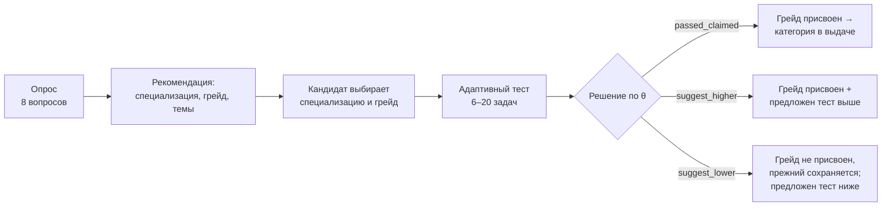
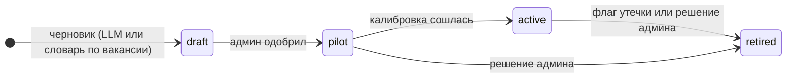

# 2. Механика тестирования и устойчивость к распространению заданий

Подробное техническое описание с формулами и полной симуляцией —
[`docs/testing/engine.md`](../testing/engine.md); состав банка по специализациям —
[`docs/testing/bank/`](../testing/bank/); правила опроса — [`docs/testing/survey.md`](../testing/survey.md).
Код движка: `backend/app/testing/engine/` (чистая библиотека Python + numpy), подключение
к API и БД: `backend/app/testing/`.

## 2.1. Проблема и наш ответ

ТЗ называет две ловушки:

1. **Единый набор заданий** быстро расходится по рынку — ответы выучивают.
2. **Уникальные задания от нейросети** под каждого кандидата не гарантируют одинаковую
   сложность — результаты разных людей нельзя честно сравнить, а правильность ключа никто
   не проверял.

Наш подход — **параметрические шаблоны с измеренной сложностью + адаптивный тест на модели
IRT + автоматический детектор утечек**. Вариативность есть у каждого кандидата, но она
управляемая: генератор меняет данные внутри шаблона, а сложность шаблона измерена
по ответам и проверяется.

## 2.2. Путь кандидата



1. **Опрос** (`GET/POST /api/testing/survey`) — подсказка, а не оценка. Голоса вариантов
   ответа с весами вопросов дают рекомендуемую специализацию (и две альтернативы с долей),
   опыт — стартовый грейд, ответы и ключевые слова свободного ответа — до пяти тем теста.
2. **Выбор** — кандидат может согласиться или выбрать другую специализацию и грейд.
3. **Тест** (`POST /api/testing/sessions`, далее `GET …/{id}` и `POST …/{id}/answers`) —
   адаптивный, задачи подбираются под текущую оценку уровня.
4. **Итог** (`GET …/{id}/result`) — θ, 90% доверительный интервал, разбор по темам
   («сильная» / «слабая»), решение по грейду. Категория появляется в профиле и в выдаче
   работодателю.

## 2.3. Банк параметрических шаблонов

Задача — это **шаблон**, а не текст. Шаблон хранит специализацию, тему, целевой грейд,
формат, генератор, проверку, параметры IRT `a` и `b`, статус и лимит времени.
`generate(seed)` детерминирован: один seed — один вариант, его можно восстановить и
перепроверить. Ответ вычисляет сам генератор, код кандидата не запускается.

**Банк MVP: 192 шаблона** — по 32 на каждую из 6 специализаций (30 основных + 2 примера),
52 темы. Каждый шаблон даёт **не меньше 50 разных вариантов** (backend и frontend — от 100);
это проверяет общий тест банка `test_engine_bank_full.py`.

| Формат | Шаблонов | Пример (что меняется от варианта к варианту) |
|---|---|---|
| `numeric` — число | 49 | сколько строк вернёт JOIN (таблицы, тип JOIN) |
| `single_choice` — один ответ | 40 | сложность алгоритма (код циклов, имена, порядок вариантов) |
| `code_output` — что выведет код | 40 | порядок вывода event loop JS (набор `console.log` / `setTimeout` / `Promise`) |
| `multi_choice` — несколько ответов | 24 | граничные значения в QA (поле, диапазон, метод) |
| `find_bug_line` — строка с ошибкой | 14 | ошибка в Kotlin или в Dockerfile (вид ошибки, имена, лишние строки) |
| `ordering` — порядок шагов | 13 | жизненный цикл Android Activity (сценарий, перемешивание) |
| `short_text` — короткий ответ | 12 | адрес сети / broadcast по CIDR (IP, маска) |

Грейды шаблонов: Стажёр 37, Junior 53, Middle 59, Senior 43.

В админке («Банк задач») видно 222 записи: эти 192 шаблона движка и 30 демо-записей из
фикстур (`data/seed/items.json`) — они показывают экраны метрик и предпросмотра, но генератора
в движке у них нет, в адаптивный тест и валидацию они не попадают.

**Ключи сверены с настоящими системами**, а не «на глаз»: SQL-шаблоны выполняются в SQLite
(и в PostgreSQL 16 для шаблонов про транзакции), JS — в Node.js, Python-код — настоящим
интерпретатором, CIDR — модулем `ipaddress`, CSS — независимым подсчётом специфичности.
Отдельный тест следит, чтобы позиция верного ответа не повторялась (ни один ключ не встречается
больше чем в половине вариантов). Подробно по каждому шаблону — `docs/testing/bank/<spec>.md`.

Пример: два кандидата получают один шаблон «граничные значения» и видят разные задачи —
«Число гостей от 1 до 17» и «Срок кредита от 4 до 114 мес.» — с разными числами и порядком
вариантов. Ответ одного другому не подходит.

## 2.4. Модель IRT и оценка уровня

Двухпараметрическая логистическая модель (2PL):

```
P(верно | θ) = 1 / (1 + e^(−a·(θ − b)))
```

- θ — уровень кандидата (по популяции среднее 0, разброс 1);
- `b` — сложность (при θ = b шанс 50%), `a` — различающая сила.

Уровень оценивается методом EAP на сетке θ от −4 до 4 (81 точка); стандартная ошибка
SE — разброс апостериорного распределения. Априор — нормальный с центром по заявленному
грейду (Стажёр −1,5; Junior −0,5; Middle 0,5; Senior 1,5): старт быстрее, но после
6 ответов данные перевешивают априор. Стартовые `a`, `b` шаблона задаёт эксперт по грейду,
затем их уточняет калибровка (2.8).

## 2.5. Адаптивный тест (CAT)

Каждый шаг:

1. текущая θ — по проверочным ответам с априором заявленного грейда;
2. из банка убираются уже показанные задачи, задачи из прошлых попыток кандидата, темы,
   которых в тесте уже 6 (баланс тем), и — при большом банке — задачи, показанные больше
   чем в 25% сессий (контроль экспозиции);
3. для каждой задачи — информация Фишера `a²·P·(1 − P)` в текущей θ с понижением за
   повтор темы (деление на `1 + 0,1·k`);
4. **выбирается случайная задача из пяти самых информативных** (randomesque) — даже при
   одинаковых ответах два кандидата получают разные наборы задач.

| Параметр | В продукте (API) | Где задаётся |
|---|---|---|
| Остановка по точности | SE < 0,30 | `TESTING_CAT_SE_STOP` |
| Максимум задач | 20 | `TESTING_CAT_MAX_ITEMS` |
| Минимум задач | 6 | `TESTING_CAT_MIN_ITEMS` |
| Лимит времени на задачу | 180 с (у шаблона может быть свой) | шаблон |
| Контроль экспозиции | доля показов ≤ 25%, включается при ≥ 100 активных шаблонах в специализации | `TESTING_EXPOSURE_MIN_BANK`, `exposure_max_share` в настройках |
| Сессия брошена | нет ответа дольше лимита + 30 мин → неудачная попытка | `TESTING_ABANDON_AFTER_MIN` |

**Непроверочные (пилотные) задачи** вставляются в 1–2 случайные позиции среди первых шести
показов. Кандидат их не отличает, на θ они не влияют, ответы идут в калибровку — так новые
шаблоны (в том числе созданные по вакансиям) набирают статистику без риска для оценки.

**Время считает сервер** по своим часам от выдачи задачи; ответ после лимита засчитывается
как неверный. Время каждого ответа сохраняется — оно нужно детектору утечек.

**Ключ не покидает сервер.** Клиент получает только формулировку, варианты и код. Ключ,
id шаблона и seed остаются в БД (`test_answers`), наружу уходит непрозрачный `instance_id`.
Верно/неверно во время теста не сообщается, правильные ответы после теста не показываются.

**Состояние** сессии целиком сериализуется в `test_sessions.engine_state` (JSON), случайность
выводится из seed сессии и номера шага: сессию можно прервать, восстановить и получить тот же
результат; бэкенд не держит состояния в памяти.

## 2.6. Грейд и правила частоты

Пороги θ (настраиваются админом по каждой специализации, `platform_settings.grade_thresholds`):
Junior от −1,0; Middle от 0,0; Senior от 1,0; ниже −1,0 — Стажёр. При нормальном распределении
уровней это примерно 16% / 34% / 34% / 16%.

| Исход | Условие | Что происходит |
|---|---|---|
| `passed_claimed` | θ не ниже порога заявленного грейда | грейд присваивается |
| `suggest_higher` | нижняя граница 90% ДИ (θ − 1,645·SE) выше порога следующего грейда | грейд присваивается, предлагается тест на грейд выше |
| `suggest_lower` | θ ниже порога заявленного грейда | грейд не присваивается (прежний сохраняется), предлагается тест на грейд ниже |

**Принудительного понижения нет** — как требует ТЗ. Тест на Стажёра пройти можно всегда.

Частота (настройки `grade_change_cooldown_days`, `retry_cooldown_days`):

- **смена грейда — не чаще раза в 90 дней** («раз в три месяца» из ТЗ);
- повтор неудачной попытки на тот же грейд — через 30 дней;
- первое присвоение грейда сменой не считается: после первого теста можно сразу пройти
  тест ниже (если не прошёл) или выше (если предложено);
- подтверждение текущего грейда сменой не считается.

Запрет отвечает `409 cooldown_active` с причиной (`details.reason_code`) и датой, когда станет
можно (`details.available_at`); экран «Категория и грейд» показывает это заранее.

## 2.7. Детектор утечек

Работает по журналу ответов, по каждому шаблону, в окне последних 300 ответов.

1. **IRT-сигнал.** Ожидаемая доля верных — среднее P(верно) по θ отвечавших, причём θ
   считается **без этой задачи** (`test_answers.theta_loo`), чтобы слитая задача сама не
   подтягивала оценку. Флаг: не меньше 30 ответов, z ≥ 3,5 и рост доли верных не меньше
   10 п. п.
2. **Сигнал скорости.** «Быстрый верный» — верный ответ быстрее 35% медианного времени по
   задаче. Флаг: не меньше 4 таких ответов и вероятность случайно получить столько
   (хвост Пуассона) меньше 10⁻⁴.

Помеченный шаблон выводится из оборота (`retired`), событие пишется в журнал, админ видит
флаг в банке задач. Запуск — автоматически после каждой 50-й завершённой сессии
(`TESTING_LEAK_SCAN_EVERY`) и вручную: `POST /api/admin/items/leak-scan`.

**Аномалии кандидата:** два и больше быстрых верных ответа на задачи, сложные для его уровня
(шанс ниже 60% по θ без этой задачи), плюс индекс согласия ответов l_z < −3. Это повод для
ручной проверки, а не автоматическое наказание.

## 2.8. Калибровка и жизненный цикл шаблона



Пересчёт `a`, `b` (`POST /api/admin/items/recalibrate`) — логистическая регрессия ответа на θ
отвечавших (без этой задачи), метод Ньютона со слабым априором вокруг текущих значений, рамки
a ∈ [0,2; 4], b ∈ [−4; 4]. Пересчитываются шаблоны с не меньше чем 30 ответами
(`TESTING_CALIBRATION_MIN_RESPONSES`). Пилот становится рабочим, когда: не меньше 150 ответов,
оценка сошлась, a ≥ 0,4, |b| ≤ 3,5, SE(b) ≤ 0,35.

## 2.9. Задания и тесты из текста вакансии

ТЗ просит показать, как система формирует задания по описаниям вакансий. Админ вставляет
текст вакансии (`POST /api/admin/vacancy-tests`, экран `/admin/vacancy-tests`):

1. правила определяют специализацию и грейд (с объяснением «по каким словам»);
2. словарь тем находит темы с уверенностью;
3. по каждой теме из банка берётся шаблон ближайшего грейда — получается тест;
4. если темы в банке нет — создаётся **черновик** шаблона (с ключом LLM его пишет модель,
   ответ проверяется Pydantic; без ключа — заготовка словаря). Черновик одобряет админ,
   дальше он идёт в тесты как непроверочный и калибруется.

Проверка на 5 образцах вакансий (`data/samples/vacancies/`): специализация верна 5 из 5,
грейд 5 из 5, ожидаемые темы найдены 25 из 25 — [`docs/validation/vacancy_tests.md`](../validation/vacancy_tests.md).

## 2.10. Почему механика устойчива к распространению заданий

| Защита | Что делает | Чем подтверждено |
|---|---|---|
| Параметризация | у каждого кандидата свой вариант; слитый ответ подходит к чужому варианту лишь случайно | утечка 20% банка, текущий банк 192 шаблона: завышение грейда у «читеров» 39,0% → 12,7% (фон честных — 10–11%); в симуляции движка 85% → 14% |
| Адаптивность + случайный выбор из топ-5 | разные кандидаты видят разные наборы задач; «полного списка вопросов» не существует | у каждой сессии свой набор |
| Контроль экспозиции | ни одна задача не показывается больше чем в 25% сессий (при банке от 100 шаблонов в направлении) | максимум показов в симуляции движка — 25,0% |
| Детектор утечек | слитая задача выводится из оборота автоматически | текущий банк: найдены все 36 слитых шаблонов, 2 ложных из 156 (точность 95%), завышение 39% → 13%; симуляция движка: полнота 94%, точность 100% |
| Непроверочные задачи | банк постоянно пополняется, новые шаблоны не влияют на оценку до калибровки | тест «пилотные задачи не влияют на θ» |
| Ключ не покидает сервер | клиенту не уходят ответ, id шаблона и seed; ответы после теста не показываются | тест публичной части варианта |
| Время по часам сервера | быстрые верные ответы видны детектору и в аномалиях кандидата | детектор кандидатов без параметризации: точность 99%, полнота 71% (текущий банк); в симуляции движка — 83% без ложных обвинений |

Два уровня страхуют друг друга: с параметризацией детектору почти нечего ловить (слитый ответ
редко подходит) — и вреда тоже нет; если какой-то шаблон всё же один на всех, его находит
детектор.

## 2.11. Почему не «одна нейросеть генерирует задания каждому»

У сгенерированной на лету задачи нет измеренных `a` и `b`: два кандидата получают задания
неизвестной и разной трудности, их баллы несопоставимы; за правильность ключа никто не ручается.
У нас нейросеть используется там, где она безопасна: по тексту вакансии она предлагает
**черновики** шаблонов. Черновик проверяет человек, затем шаблон проходит пилот и калибровку —
и только после этого влияет на оценки. Без ключа LLM механика работает полностью.

## 2.12. Результаты проверки механики

**Платформа на текущем банке** — 1200 синтетических кандидатов с известным истинным θ проходят
настоящий онбординг (тест на заявленный грейд, ниже или выше по правилам 2.6) на рабочем банке
192 шаблона с настройками стенда (SE < 0,30, до 20 задач), seed 20261011; воспроизводится
`make validate`, подробно — [`docs/validation/report.md`](../validation/report.md):

| Метрика | Значение |
|---|---|
| Корреляция θ̂ с истинным θ / RMSE | 0,940 / 0,358 |
| Грейд по θ̂ одного теста: точно / ±1 | 80,2% / 99,8% |
| **Итоговая категория: точно / ±1** | **78,8% / 100,0%** (по заявленному грейду было бы 64,9%) |
| Категория точно, если истинный θ дальше 0,25 от порога | 84,5% |
| Средняя длина теста / средняя итоговая SE | 20,0 задачи / 0,374 |
| Повтор онбординга: та же категория / каппа Коэна | 75,6% / 0,663 |
| Различающая сила: средняя r_pb по 192 шаблонам / доля > 0,2 | 0,430 / 100% |
| Утечка 20% банка: завышение у читеров без защиты → с параметризацией | 39,0% → 12,7% (фон 10,7%) |
| Детектор утечек (шаблон один на всех): полнота / точность | 100% / 95% |

**Движок на большом синтетическом банке** — 1000 кандидатов, банк 240 задач, правило
по умолчанию движка (SE < 0,35 или 15 задач), seed 20261011; воспроизводится командой
`PYTHONPATH=backend python -m app.testing.engine.simulate --seed 20261011`:

| Метрика | Значение |
|---|---|
| Корреляция оценки θ с истинным θ | 0,945 |
| RMSE θ | 0,332 |
| Грейд точно / ±1 | 78,4% / 100% |
| Грейд точно, если истинный θ дальше 0,25 от порога | 88,5% |
| Средняя длина теста (стоп SE < 0,35 или 15 задач) | 12,8 |
| Повтор: тот же грейд / каппа Коэна | 67,9% / 0,558 |
| Повтор: то же решение по заявленному грейду / каппа | 86,4% / 0,587 |
| Повтор при правиле продукта (SE < 0,30 или 20 задач): тот же грейд / каппа | 73,6% / 0,636 |
| Различающая сила: средняя `a` банка; r_pb на линейной форме 30 задач | 1,32; 0,348 (100% задач > 0,2) |
| Ошибка калибровки ±0,2 → корреляция | 0,932 |
| Калибровка 30 пилотов × 300 ответов: RMSE `a` / `b`; переведено в рабочие | 0,198 / 0,228; 90% |

Почему цифры двух таблиц различаются: на большом банке тест останавливается раньше (12,8 задачи)
и выбирает самые информативные задачи; на текущем банке из 32 шаблонов в направлении цель
SE < 0,30 недостижима, поэтому все тесты идут до 20 задач. Повтор в первой таблице — совпадение
итоговой категории после всего онбординга, во второй — грейда по одному тесту. Подробно,
с графиками и разбором подбора — [раздел 4](04_validation.md).

## 2.13. Ограничения и что дальше

- **Банк MVP — 32 шаблона на специализацию.** На нём тест всегда идёт 20 задач и заканчивает
  со средней SE 0,37 (цель 0,30 не достигается), показывает больше половины банка, повтор даёт
  ту же категорию в 76% случаев; контроль экспозиции поэтому выключен (включается при ≥ 100
  активных шаблонах). Точность ещё растёт с размером банка (16 шаблонов — грейд точно 75,0%,
  32 — 79,8%). По симуляции движка 120+ шаблонов на специализацию дают SE 0,34–0,37 за
  12–15 задач — это главный путь к стабильности. Параметризация защищает и маленький банк.
- **Равенство вариантов внутри шаблона** по сложности — допущение; проверяется на реальных
  ответах калибровкой по группам вариантов, шаблоны с разбросом стоит дробить.
- **Модель времени** в симуляции — допущение; на реальных данных пороги сигнала скорости
  нужно проверить по истории (код уже оценивает фон по всему банку).
- **Пороги грейдов** −1 / 0 / 1 — стартовые; после набора данных их стоит согласовать
  с экспертной оценкой.
