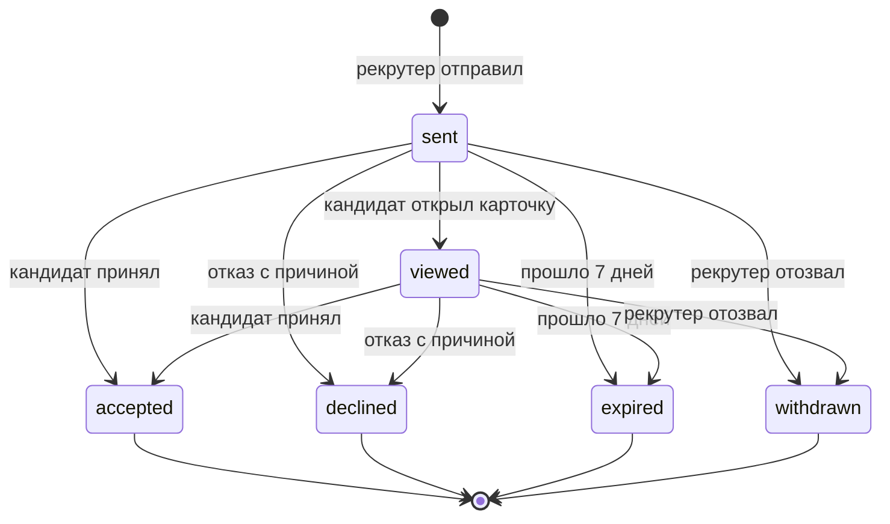

# 3. Механика подбора и логика категоризации

Код: `backend/app/matching/` (потребности, категории, подборка, счёт — `scoring.py`),
`backend/app/invitations/` (приглашения, квота, рыночная подсказка, контакты),
`backend/app/candidates/` (обезличенная карточка, банк кандидатов), `backend/app/fsp/`
(ФСП-скор), `backend/app/nlp/` (разбор текста потребности, сравнение стека).

## 3.1. Идея: работодатель приходит сам

Классическая площадка: кандидат рассылает отклики, работодатель разбирает сотни резюме.
У нас наоборот — по модели LHH из ТЗ:

1. кандидат один раз проходит опрос и тест → получает **категорию**;
2. работодатель описывает потребность → видит **рекомендованные категории** и внутри них
   **ранжированную подборку с объяснением**;
3. работодатель выбирает конкретного человека и отправляет **приглашение с зарплатной
   вилкой** — кандидат видит условия до начала общения;
4. кандидат принимает или отклоняет с причиной; **контакты открываются только после
   принятия**.

Приглашение — ценный ресурс: у рекрутера квота активных приглашений, вилку ниже ожиданий
кандидата отправить нельзя, отказ возвращается с причиной. Так нет спама и есть обратная связь
обеим сторонам.


## 3.2. Категоризация кандидата

**Категория = специализация × грейд**, код `"<spec>:<grade>"` (например `backend:middle`,
подпись «Backend · Middle»).

| Справочник | Значения |
|---|---|
| Специализации (6) | `backend` Backend, `frontend` Frontend, `mobile` Mobile, `data_ml` Data Science / ML, `qa` QA, `devops` DevOps |
| Грейды (4) | `intern` Стажёр, `junior` Junior, `middle` Middle, `senior` Senior |
| Категории | 24 = 6 × 4 |
| Стек | справочник технологий с привязкой к специализациям и синонимами (админ пополняет) |

Откуда берётся категория:

- **специализация** — выбирает кандидат перед тестом (опрос рекомендует, но не навязывает);
  тест идёт по банку этой специализации;
- **грейд** — только по результату адаптивного теста (θ против порогов), см. раздел 2.6.
  Самоописание в резюме на грейд не влияет; принудительного понижения нет;
- кандидат попадает в выдачу, только если у него есть грейд, дано согласие на публикацию,
  поиск не на паузе и учётная запись не заблокирована.

Резюме (форма или PDF с автораспознаванием) даёт стек, опыт, роли, контакты — это
**дополнительные** данные для ранжирования внутри категории и для PDF-профиля, но не основание
для категории. Так выполняется требование ТЗ: «выдача формируется на основании категорий,
присвоенных по итогам опроса и тестирования, а не самоописанных данных резюме».

## 3.3. Потребность работодателя

Рекрутер описывает потребность формой (`POST /api/matching/needs`) или свободным текстом:
`POST /api/matching/needs/parse` разбирает фразу вида «нужен сеньор на Go в финтех, удалёнка,
300–400к» в поля, рекрутер проверяет и сохраняет. Разбор — правилами и
справочником синонимов; с ключом LLM — точнее. Проверка на 12 формулировках с эталоном —
12 из 12 по всем полям ([`docs/validation/need_parsing.md`](../validation/need_parsing.md)).

Поля: название, специализация, грейд, обязательный и желательный стек (коды справочника,
неизвестные — `422 unknown_skills`), описание команды, формат работы, город, **вилка от–до
(обязательно, от ≤ до)**.

## 3.4. Рекомендованные категории

`GET /api/matching/needs/{id}/categories` — основная категория потребности, соседние грейды
(±1) и смежные специализации того же грейда, у каждой — число кандидатов в выдаче:

| Специализация потребности | Смежные |
|---|---|
| Backend | DevOps, Data Science / ML |
| Frontend | Mobile, Backend |
| Mobile | Frontend |
| Data Science / ML | Backend |
| QA | Backend, Frontend |
| DevOps | Backend |

Если в основной категории мало людей, рекрутер видит, куда расширить поиск, и переключает
категорию одним кликом.

## 3.5. Ранжирование внутри категории

`GET /api/matching/needs/{id}/candidates?category=…` считает для каждого кандидата категории
**счёт 0..1** — взвешенную сумму шести факторов (`backend/app/matching/scoring.py`):

```
счёт = Σ value(фактор) × weight(фактор),   value ∈ [0; 1],   Σ weight = 1
```

| Фактор | Вес по умолчанию | Как считается value |
|---|---|---|
| **Стек** (`stack`) | 0,30 | покрытие стека потребности: обязательные технологии — 75%, желательные — 25%; точное совпадение или синоним — 1, смежная технология — частичный вклад из справочника смежности (например, FastAPI ↔ Django = 0,5) |
| **Результат теста** (`theta`) | 0,25 | Φ(θ) — доля специалистов с уровнем ниже (θ ~ N(0, 1)); без теста — 0 |
| **Достижения ФСП** (`fsp`) | 0,15 | ФСП-скор / 100, если кандидат показывает достижения; нет истории — 0 (бонуса нет, штрафа нет) |
| **Свежесть профиля** (`freshness`) | 0,10 | 0..1, растёт за решённые регулярные задания |
| **Зарплата** (`salary`) | 0,10 | 1 — минимум кандидата не выше «от» вилки; 0,7 — не выше «до»; иначе 0 |
| **Формат работы** (`work_format`) | 0,10 | 1 — совпадает; 0,5 — кандидат на гибриде, а нужна удалёнка или гибрид; иначе 0 |

Веса хранятся в настройках платформы (`platform_settings.ranking_weights`), админ меняет их
на экране «Справочники» (`PUT /api/admin/settings`) без релиза; при расчёте они нормируются
к сумме 1, поэтому сумма вкладов точно равна счёту. При равном счёте порядок стабильный
(по id кандидата).

Почему такие веса: категория уже гарантирует нужную специализацию и подтверждённый грейд,
поэтому внутри неё главное — **совпадение стека** и **сила результата теста** (вместе 55%);
**ФСП** — объективное внешнее подтверждение, как требует ТЗ («выше те, у кого есть
подтверждённые достижения ФСП»), но не настолько тяжёлое, чтобы кандидат без истории ФСП
не мог оказаться в топе; зарплата, формат и свежесть — практические условия выхода на контакт.

## 3.6. Объяснимость: «почему в подборке»

Каждая строка подборки содержит:

- **разбивку счёта** (`breakdown`): по каждому фактору value, вес и вклад — на экране это
  полоски;
- **2–4 причины текстом** (`reasons`) по самым весомым факторам, например:
  «Стек: 3 из 4 обязательных (Go, PostgreSQL, Kafka), плюс Kubernetes»,
  «Тест сильнее, чем у 87 % специалистов; сильные темы: Базы данных и SQL, Конкурентность»,
  «Подтверждено ФСП: призёр всероссийского хакатона по продуктовому программированию, 2026»,
  «Ожидания по зарплате укладываются в вилку», «Готов работать: удалённо»;
- `salary_fit` — укладывается ли минимум кандидата в вилку (без раскрытия суммы);
- статус последнего приглашения этой компании кандидату, чтобы не пригласить дважды.

Пример реального ответа (демо-данные, категория «Backend · Senior»):

```json
{
  "score": 0.4017,
  "reasons": [
    "Тест сильнее, чем у 95 % специалистов; сильные темы: HTTP и REST API, Конкурентность и асинхронность",
    "Категория по тесту: Backend · Senior"
  ],
  "breakdown": [
    {"factor": "stack", "label": "Стек", "value": 0.2625, "weight": 0.3, "contribution": 0.0788},
    {"factor": "theta", "label": "Результат теста", "value": 0.9474, "weight": 0.25, "contribution": 0.2369},
    {"factor": "fsp", "label": "Достижения ФСП", "value": 0.0, "weight": 0.15, "contribution": 0.0},
    {"factor": "freshness", "label": "Свежесть профиля", "value": 0.36, "weight": 0.1, "contribution": 0.036},
    {"factor": "salary", "label": "Зарплата", "value": 0.0, "weight": 0.1, "contribution": 0.0},
    {"factor": "work_format", "label": "Формат работы", "value": 0.5, "weight": 0.1, "contribution": 0.05}
  ],
  "salary_fit": false
}
```

## 3.7. Уточнение запроса без потери подборки

Фильтры подборки — стек (все выбранные технологии), «есть ФСП», формат работы, город —
применяются поверх уже посчитанного списка: ответ содержит `total_before_filters` и `total`,
порядок не пересчитывается, сброс фильтров возвращает исходную подборку. Отдельно есть
**банк кандидатов** (`GET /api/candidates`) — поиск по всей базе с фильтрами по специализации,
грейду, категории, стеку, наличию ФСП, формату и городу, сортировка по тесту, ФСП, свежести
или новизне.

## 3.8. Обезличенный профиль

До принятия приглашения рекрутер видит (`GET /api/candidates/{id}`, карточки подборки):

| Видно | Скрыто |
|---|---|
| псевдоним «Кандидат #XXXX», категория, θ и темы теста («сильные» / «слабые»), стек, роли в команде, форматы работы, бейджи и ФСП-скор с пометкой «подтверждено ФСП» | ФИО, почта, телефон, Telegram, минимальная зарплата, ФСП ID; город, стаж и ссылки — если кандидат не разрешил их показывать; блок ФСП — если кандидат его скрыл |

Контакты — отдельный объект `contacts`; он заполняется только после принятия приглашения
этой компании или если кандидат сам откликнулся на её вакансию.

## 3.9. Приглашение: выход на контакт

`POST /api/invitations` — без обязательной привязки к вакансии (можно указать потребность
или вакансию для контекста):

| Поле | Обязательно | Правило |
|---|---|---|
| описание предложения | да | |
| вилка `salary_from`–`salary_to`, ₽ | да | от > 0, от ≤ до (`422 validation_error`, `salary_range_invalid` в `details.errors`) |
| способ связи | да | `email`, `phone`, `telegram`, `other` + значение |
| компания | — | подставляется из профиля рекрутера |
| короткое задание | нет | текст задания для кандидата |

Проверки при отправке:

| Ситуация | Ответ |
|---|---|
| максимум вилки ниже минимальной зарплаты кандидата | `422 salary_below_expectations` — **сумма ожиданий не раскрывается**, только факт |
| у кандидата уже есть активное приглашение от этой компании | `409 already_invited` |
| квота рекрутера исчерпана (по умолчанию 20 активных, т.е. «отправлено» и «просмотрено») | `409 quota_exceeded` с подсказкой отозвать неактуальные |
| кандидат скрыл профиль, на паузе или не найден | `404 not_found` |

Кандидату уходит письмо с компанией и вилкой («Ваши контакты компания увидит, только если вы
примете приглашение»). Приглашение действует 7 дней (`invitation_ttl_days`).

### Статусы



Недопустимый переход — `409 invalid_transition`. Каждое изменение пишется в журнал событий
приглашения (`invitation_events`); обе стороны видят актуальный статус и историю
(`GET /api/invitations/{id}`). Истечение срока применяется при любом обращении к приглашениям.

**Отказ с причиной** (`POST /api/invitations/{id}/decline`): «Мала зарплата», «Не тот стек»,
«Не интересна сфера», «Не ищу работу сейчас», «Другое» (для «Другое» комментарий обязателен).
Рекрутер получает письмо с причиной и видит её в списке — это обратная связь о рынке.

**Раскрытие контактов** (`POST /api/invitations/{id}/accept`): рекрутер видит ФИО, почту,
телефон и Telegram кандидата, кандидат — контакты рекрутера; событие `contacts_revealed`
пишется в журнал приглашения и в `audit_log`, рекрутеру уходит письмо с контактами.

## 3.10. Рыночная подсказка

`GET /api/invitations/market-hint?category=…&salary_from=…&salary_to=…` — показывается
в окне приглашения:

- если в категории принято не меньше 3 приглашений — медиана принятых вилок
  («В категории Backend · Middle обычно принимают от 250 000 ₽»);
- иначе — оценка по минимальным ожиданиям кандидатов категории (медиана, округление
  до 10 000 ₽);
- **вероятность принятия** с введённой вилкой: доля кандидатов категории, чей минимум
  не выше верхней границы, с поправкой на то, насколько «от» ниже медианы; ограничена
  5–95%. При малой выборке подсказка честно говорит «пока мало данных».

Цель — чтобы рекрутер сразу ставил рыночную вилку, а не тратил приглашения из квоты.

## 3.11. Отклик на вакансию — дополнительный сценарий

Для кандидата, который ещё не получил приглашений (ТЗ, критерий 6): рекрутер публикует
вакансию с обязательной вилкой, кандидат видит ленту с фильтрами и откликается. Статусы
отклика: `new` → `viewed` → `invited` / `rejected`, обе стороны их видят. Контакты
откликнувшегося кандидата открыты рекрутеру сразу — он проявил инициативу сам. Отклик
не заменяет основную механику: в подборке и банке кандидатов приоритет у категорий.
<!-- TODO(дирижёр): после слияния 5a проверить статусы и переходы откликов по коду -->

## 3.12. Регулярные задания и свежесть профиля

Работодатель публикует короткую задачу («решите или предложите подход»), кандидат видит её
в разделе «Задания» и отвечает, рекрутер оценивает ответы обезличенно по шкале 0–3.
Решённые задания поднимают фактор «Свежесть профиля» в ранжировании — работодатель получает
свежий сигнал о кандидате.
<!-- TODO(дирижёр): после слияния 5b описать формулу свежести по коду app/tasks -->

## 3.13. Защита от недобросовестных работодателей (концепция + часть реализации)

Квота приглашений, запрет вилки ниже ожиданий, жалоба кандидата на работодателя
(`POST /api/reports`) и **скоринг надёжности компании** в админке: 30 + 50 × доля отвеченных
приглашений (нет данных — 50), +10 за подтверждённый домен почты, −15 за подтверждённую
жалобу, −5 за жалобу в работе; админ может заблокировать компанию. Полная концепция
(подтверждение домена и ИНН, ограничения для новых компаний, интеграция с ATS) —
`docs/concepts/antifraud_ats.md` (трек 5b).

## 3.14. Качество подбора

Метрики подбора на синтетическом наборе пар «потребность — кандидат» с эталонной разметкой
(precision@10, nDCG@10, доля релевантных в топе, сравнение с базовым поиском по ключевым словам
резюме) — в [разделе 4](04_validation.md). Жюри может проверить подбор на своих парах:
`POST /api/eval/matching` принимает CSV (`need_id`, `candidate_id`, необязательно `relevant`)
и возвращает метрики.
