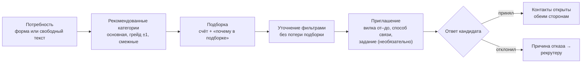
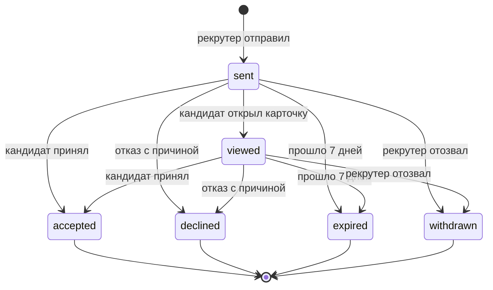
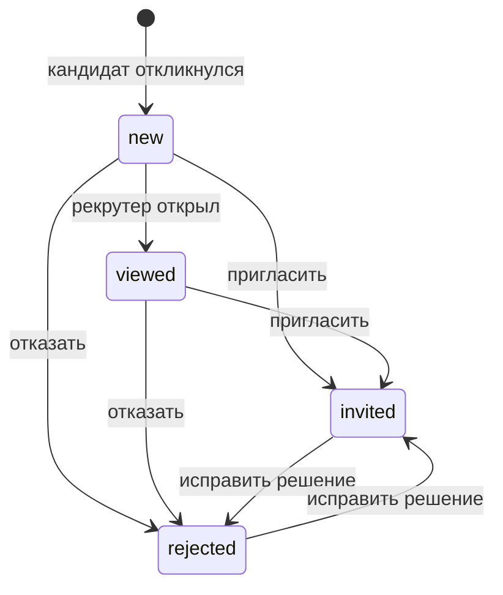

# 3. Механика подбора и логика категоризации

Код: `backend/app/matching/` (потребности, категории, подборка, счёт — `scoring.py`),
`backend/app/invitations/` (приглашения, квота, рыночная подсказка, контакты),
`backend/app/candidates/` (обезличенная карточка, банк кандидатов), `backend/app/fsp/`
(ФСП-скор), `backend/app/nlp/` (разбор текста потребности, сравнение стека),
`backend/app/vacancies/` (вакансии и отклики), `backend/app/tasks/` (регулярные задания
и свежесть профиля), `backend/app/companies/` и `backend/app/integrations/` (антифрод, ATS).

## 3.1. Идея: работодатель приходит сам

Классическая площадка: кандидат рассылает отклики, работодатель разбирает сотни резюме.
У нас наоборот — по модели LHH из ТЗ:

1. кандидат один раз проходит опрос и тест → получает **категорию**;
2. работодатель описывает потребность → видит **рекомендованные категории** и внутри них
   **ранжированную подборку с объяснением**;
3. работодатель выбирает конкретного человека и отправляет **приглашение с зарплатной
   вилкой** — кандидат видит условия до начала общения;
4. кандидат принимает или отклоняет с причиной; **контакты открываются только после
   принятия**.

Приглашение — ценный ресурс: у рекрутера квота активных приглашений, вилку ниже ожиданий
кандидата отправить нельзя, отказ возвращается с причиной. Так нет спама и есть обратная связь
обеим сторонам.



## 3.2. Категоризация кандидата

**Категория = специализация × грейд**, код `"<spec>:<grade>"` (например `backend:middle`,
подпись «Backend · Middle»).

| Справочник | Значения |
|---|---|
| Специализации (6) | `backend` Backend, `frontend` Frontend, `mobile` Mobile, `data_ml` Data Science / ML, `qa` QA, `devops` DevOps |
| Грейды (4) | `intern` Стажёр, `junior` Junior, `middle` Middle, `senior` Senior |
| Категории | 24 = 6 × 4 |
| Стек | справочник технологий с привязкой к специализациям и синонимами (админ пополняет) |

Откуда берётся категория:

- **специализация** — выбирает кандидат перед тестом (опрос рекомендует, но не навязывает);
  тест идёт по банку этой специализации;
- **грейд** — только по результату адаптивного теста (θ против порогов), см. раздел 2.6.
  Самоописание в резюме на грейд не влияет; принудительного понижения нет;
- грейд, который соискатель выбрал сам (онбординг, `PUT /api/candidates/me/declared-grade`
  или старт теста), хранится отдельно как **заявленный**: статус `grade_status = unconfirmed`,
  в кабинете — «Грейд Middle — не подтверждён» с кнопкой теста; после теста — `confirmed`,
  «подтверждён тестом <дата>» (ответ организаторов FTT.4: официально грейд присваивается
  только по результату теста). Статус виден и админу в списке пользователей;
- кандидат попадает в выдачу, только если грейд подтверждён тестом (`grade_status =
  confirmed`), дано согласие на публикацию, поиск не на паузе и учётная запись не
  заблокирована. Заявленный, но не подтверждённый грейд в подборку, банк кандидатов
  и счётчики категорий не пускает (`searchable_conditions` в `backend/app/candidates/repository.py`).

Резюме (форма или PDF с автораспознаванием) даёт стек, опыт, роли, контакты — это
**дополнительные** данные для ранжирования внутри категории и для PDF-профиля, но не основание
для категории. Так выполняется требование ТЗ: «выдача формируется на основании категорий,
присвоенных по итогам опроса и тестирования, а не самоописанных данных резюме».

## 3.3. Потребность работодателя

Рекрутер описывает потребность формой (`POST /api/matching/needs`) или свободным текстом:
`POST /api/matching/needs/parse` разбирает фразу вида «нужен сеньор на Go в финтех, удалёнка,
300–400к» в поля, рекрутер проверяет и сохраняет. Разбор — правилами и
справочником синонимов; если правила не нашли специализацию, грейд или стек, недостающее
дозаполняет локальная модель (раздел 9). Проверка на 12 формулировках с эталоном —
12 из 12 по всем полям ([`docs/validation/need_parsing.md`](../validation/need_parsing.md)).

Поля: название, специализация, грейд, обязательный и желательный стек (коды справочника,
неизвестные — `422 unknown_skills`), описание команды, формат работы, город, **вилка от–до
(обязательно, от ≤ до)**.

## 3.4. Рекомендованные категории

`GET /api/matching/needs/{id}/categories` — основная категория потребности, соседние грейды
(±1) и смежные специализации того же грейда, у каждой — число кандидатов в выдаче:

| Специализация потребности | Смежные |
|---|---|
| Backend | DevOps, Data Science / ML |
| Frontend | Mobile, Backend |
| Mobile | Frontend |
| Data Science / ML | Backend |
| QA | Backend, Frontend |
| DevOps | Backend |

Если в основной категории мало людей, рекрутер видит, куда расширить поиск, и переключает
категорию одним кликом.

## 3.5. Ранжирование внутри категории

`GET /api/matching/needs/{id}/candidates?category=…` считает для каждого кандидата категории
**счёт 0..1** — взвешенную сумму шести факторов (`backend/app/matching/scoring.py`):

```
счёт = Σ value(фактор) × weight(фактор),   value ∈ [0; 1],   Σ weight = 1
```

| Фактор | Вес по умолчанию | Как считается value |
|---|---|---|
| **Стек** (`stack`) | 0,30 | покрытие стека потребности: обязательные технологии — 75%, желательные — 25%; точное совпадение или синоним — 1, смежная технология — частичный вклад из справочника смежности (например, FastAPI ↔ Django = 0,5) |
| **Результат теста** (`theta`) | 0,25 | Φ(θ) — доля специалистов с уровнем ниже (θ ~ N(0, 1)); без теста — 0 |
| **Достижения ФСП** (`fsp`) | 0,15 | ФСП-скор / 100 **под специализацию потребности**: очки каждого достижения умножены на релевантность дисциплины (ИБ для DevOps — 1,0, робототехника — 0,5; таблица в 5.7); только если кандидат показывает достижения; нет истории — 0 (бонуса нет, штрафа нет) |
| **Свежесть профиля** (`freshness`) | 0,10 | 0..1, растёт за ответы на регулярные задания и их оценку, со временем падает вдвое за 30 дней (3.12) |
| **Зарплата** (`salary`) | 0,10 | 1 — минимум кандидата не выше «от» вилки; 0,7 — не выше «до»; иначе 0 |
| **Формат работы** (`work_format`) | 0,10 | 1 — совпадает; 0,5 — кандидат на гибриде, а нужна удалёнка или гибрид; иначе 0 |

Веса хранятся в настройках платформы (`platform_settings.ranking_weights`), админ меняет их
на экране «Справочники» (`PUT /api/admin/settings`) без релиза; при расчёте они нормируются
к сумме 1, поэтому сумма вкладов точно равна счёту. При равном счёте порядок стабильный
(по id кандидата).

Почему такие веса: категория уже гарантирует нужную специализацию и подтверждённый грейд,
поэтому внутри неё главное — **совпадение стека** и **сила результата теста** (вместе 55%);
**ФСП** — объективное внешнее подтверждение, как требует ТЗ («выше те, у кого есть
подтверждённые достижения ФСП»), но не настолько тяжёлое, чтобы кандидат без истории ФСП
не мог оказаться в топе; зарплата, формат и свежесть — практические условия выхода на контакт.

## 3.6. Объяснимость: «почему в подборке»

Каждая строка подборки содержит:

- **разбивку счёта** (`breakdown`): по каждому фактору value, вес и вклад — на экране это
  полоски;
- **2–4 причины текстом** (`reasons`) по самым весомым факторам, например:
  «Стек: 3 из 4 обязательных (Go, PostgreSQL, Kafka), плюс Kubernetes»,
  «Тест сильнее, чем у 87 % специалистов; сильные темы: Базы данных и SQL, Конкурентность»,
  «Подтверждено ФСП: призёр всероссийского соревнования по программированию систем ИБ, 2025 —
  профильно для DevOps» (пометка — если дисциплина профильная для специализации потребности),
  «Ожидания по зарплате укладываются в вилку», «Готов работать: удалённо»;
- `salary_fit` — укладывается ли минимум кандидата в вилку (без раскрытия суммы);
- статус последнего приглашения этой компании кандидату, чтобы не пригласить дважды.

Пример реального ответа (демо-данные, категория «Backend · Senior»):

```json
{
  "score": 0.4017,
  "reasons": [
    "Тест сильнее, чем у 95 % специалистов; сильные темы: HTTP и REST API, Конкурентность и асинхронность",
    "Категория по тесту: Backend · Senior"
  ],
  "breakdown": [
    {"factor": "stack", "label": "Стек", "value": 0.2625, "weight": 0.3, "contribution": 0.0788},
    {"factor": "theta", "label": "Результат теста", "value": 0.9474, "weight": 0.25, "contribution": 0.2369},
    {"factor": "fsp", "label": "Достижения ФСП", "value": 0.0, "weight": 0.15, "contribution": 0.0},
    {"factor": "freshness", "label": "Свежесть профиля", "value": 0.36, "weight": 0.1, "contribution": 0.036},
    {"factor": "salary", "label": "Зарплата", "value": 0.0, "weight": 0.1, "contribution": 0.0},
    {"factor": "work_format", "label": "Формат работы", "value": 0.5, "weight": 0.1, "contribution": 0.05}
  ],
  "salary_fit": false
}
```

## 3.7. Уточнение запроса без потери подборки

Фильтры подборки — стек (все выбранные технологии), «есть ФСП», формат работы, город —
применяются поверх уже посчитанного списка: ответ содержит `total_before_filters` и `total`,
порядок не пересчитывается, сброс фильтров возвращает исходную подборку. Отдельно есть
**банк кандидатов** (`GET /api/candidates`) — поиск по всей базе с фильтрами по специализации,
грейду, категории, стеку, наличию ФСП, формату и городу, сортировка по тесту, ФСП, свежести
или новизне.

## 3.8. Обезличенный профиль

До принятия приглашения рекрутер видит (`GET /api/candidates/{id}`, карточки подборки):

| Видно | Скрыто |
|---|---|
| псевдоним «Кандидат #XXXX», категория, θ и темы теста («сильные» / «слабые»), стек, роли в команде, форматы работы, бейджи и ФСП-скор с пометкой «подтверждено ФСП» | ФИО, почта, телефон, Telegram, минимальная зарплата, ФСП ID; город, стаж и ссылки — если кандидат не разрешил их показывать; блок ФСП — если кандидат его скрыл |

Контакты — отдельный объект `contacts`; он заполняется только после принятия приглашения
этой компании или если кандидат сам откликнулся на её вакансию.

## 3.9. Приглашение: выход на контакт

`POST /api/invitations` — без обязательной привязки к вакансии (можно указать потребность
или вакансию для контекста):

| Поле | Обязательно | Правило |
|---|---|---|
| описание предложения | да | |
| вилка `salary_from`–`salary_to`, ₽ | да | от > 0, от ≤ до (`422 validation_error`, `salary_range_invalid` в `details.errors`) |
| способ связи | да | `email`, `phone`, `telegram`, `other` + значение |
| компания | — | подставляется из профиля рекрутера |
| короткое задание | нет | текст задания для кандидата |

Проверки при отправке:

| Ситуация | Ответ |
|---|---|
| максимум вилки ниже минимальной зарплаты кандидата | `422 salary_below_expectations` — **сумма ожиданий не раскрывается**, только факт |
| у кандидата уже есть активное приглашение от этой компании | `409 already_invited` |
| квота рекрутера исчерпана (по умолчанию 20 активных, т.е. «отправлено» и «просмотрено») | `409 quota_exceeded` с подсказкой отозвать неактуальные |
| кандидат скрыл профиль, на паузе или не найден | `404 not_found` |

Кандидату уходит письмо с компанией и вилкой («Ваши контакты компания увидит, только если вы
примете приглашение»). Приглашение действует 7 дней (`invitation_ttl_days`).

### Статусы



Недопустимый переход — `409 invalid_transition`. Каждое изменение пишется в журнал событий
приглашения (`invitation_events`); обе стороны видят актуальный статус и историю
(`GET /api/invitations/{id}`). Истечение срока применяется при любом обращении к приглашениям.

**Отказ с причиной** (`POST /api/invitations/{id}/decline`): «Мала зарплата», «Не тот стек»,
«Не интересна сфера», «Не ищу работу сейчас», «Другое» (для «Другое» комментарий обязателен).
Рекрутер получает письмо с причиной и видит её в списке — это обратная связь о рынке.

**Раскрытие контактов** (`POST /api/invitations/{id}/accept`): рекрутер видит ФИО, почту,
телефон и Telegram кандидата, кандидат — контакты рекрутера; событие `contacts_revealed`
пишется в журнал приглашения и в `audit_log`, рекрутеру уходит письмо с контактами.

## 3.10. Рыночная подсказка

`GET /api/invitations/market-hint?category=…&salary_from=…&salary_to=…` — показывается
в окне приглашения:

- если в категории принято не меньше 3 приглашений — медиана принятых вилок
  («В категории Backend · Middle обычно принимают от 250 000 ₽»);
- иначе — оценка по минимальным ожиданиям кандидатов категории (медиана, округление
  до 10 000 ₽);
- **вероятность принятия** с введённой вилкой: доля кандидатов категории, чей минимум
  не выше верхней границы, с поправкой на то, насколько «от» ниже медианы; ограничена
  5–95%. При малой выборке подсказка честно говорит «пока мало данных».

Цель — чтобы рекрутер сразу ставил рыночную вилку, а не тратил приглашения из квоты.

## 3.11. Отклик на вакансию — дополнительный сценарий

Для кандидата, который ещё не получил приглашений (ТЗ, критерий 6): рекрутер публикует
вакансию, кандидат видит ленту с фильтрами и откликается. Отклик не заменяет основную
механику: в подборке и банке кандидатов приоритет у категорий.

**Вакансия** (`POST/PUT /api/vacancies`): название, специализация, грейд, обязательный
и желательный стек (только коды справочника, иначе `422 unknown_skills`), описание, «чем
занимается команда», формат, город, **вилка от–до обязательна, от ≤ до**. Создаётся
черновиком своей компании; статусы `draft → published ⇄ unpublished`
(`POST /api/vacancies/{id}/publish`, `…/unpublish`, иначе `409 invalid_transition`).
Рекрутер видит и меняет только вакансии своей компании (чужая — `404`).

**Лента** (`GET /api/vacancies` для соискателя): только опубликованные вакансии
незаблокированных компаний; фильтры — специализация, грейд, формат, стек (все выбранные
технологии), «зарплата до не ниже», поиск по тексту; пагинация `limit` / `offset`, всего —
в заголовке `X-Total-Count`. В карточке — `my_application_id`, если кандидат уже откликнулся.

**Отклик** (`POST /api/vacancies/{id}/applications`, необязательное сопроводительное письмо):
только на опубликованную вакансию и один раз (`409 already_applied`). **Контакты
откликнувшегося открыты компании сразу** — кандидат проявил инициативу сам; раскрытие пишется
в `audit_log` (`contacts_revealed`), рекрутерам компании уходит письмо с контактами,
в ATS компании — вебхук `application.created` (3.13). В списке откликов рекрутер видит
контакты, категорию и результат теста кандидата.



Статус меняет рекрутер (`PATCH /api/applications/{id}`): `new → viewed → invited / rejected`;
вернуться к `new` или `viewed` нельзя (`409 invalid_transition`), `invited ⇄ rejected` —
исправление решения. Кандидат видит статус в своих откликах (`GET /api/applications`) и получает
письмо о каждой смене («работодатель посмотрел ваш отклик», «приглашает пообщаться — ваши
контакты у него есть», «выбрал другого кандидата»).

## 3.12. Регулярные задания и свежесть профиля

Работодатель публикует короткую задачу («решите или предложите подход») для категории
(`POST /api/tasks`: название, условие, категория, срок ответа 1–30 дней, по умолчанию 7).
Кандидат видит её в разделе «Задания» (`GET /api/tasks/inbox`) и отвечает
(`POST /api/tasks/submissions/{id}/answer`), рекрутер оценивает ответы **обезличенно** —
видит карточку «Кандидат #XXXX», а не ФИО — по шкале 0–3 с комментарием
(`POST /api/tasks/submissions/{id}/grade`). Код — `backend/app/tasks/`.

**Раздача.** Задание получают кандидаты его категории, у которых нет активного задания и
которым оно ещё не выдавалось (не заблокированы, поиск не на паузе); первыми — те, кто дольше
всех был без заданий; не больше 50 за проход (`TASKS_MAX_ASSIGN_PER_RUN`). Раздача идёт сразу
при создании задания, по повторной раздаче рекрутером (`POST /api/tasks/{id}/distribute`) и по расписанию. Задания
заблокированных компаний не раздаются. Жизненный цикл выданного задания:
`assigned → submitted → graded` или `assigned → expired` (срок вышел без ответа; ответ после
срока — `409 submission_expired`). У кандидата одновременно не больше одного активного задания.

**Свежесть профиля** (`candidate_profiles.freshness`, 0..1) — фактор ранжирования (3.5):

| Событие | Изменение свежести | Настройка |
|---|---|---|
| Кандидат отправил ответ | +0,08 | `TASKS_FRESHNESS_ANSWER_BONUS` |
| Рекрутер впервые оценил ответ баллом 0–3 | +0,04 + 0,03 × балл (от +0,04 до +0,13) | `TASKS_FRESHNESS_GRADE_BASE`, `TASKS_FRESHNESS_GRADE_PER_POINT` |
| Переоценка ответа | ± 0,03 × разница баллов | — |
| Каждые сутки (планировщик) | × 0,5^(дней / 30) — вдвое за 30 дней; новые ответы и оценки перекрывают снижение | `TASKS_FRESHNESS_HALF_LIFE_DAYS` |

Значение ограничено отрезком [0; 1]. Пример: ответ, оценённый на 3, даёт 0,08 + 0,13 = 0,21;
через 30 дней без новых ответов от этого остаётся 0,105. При свежести от 0,6 в объяснении
подборки появляется причина «Профиль свежий: недавно решал задания».

**Периодические работы** (cron или запрос администратора):

| Команда (из каталога `backend/`) | Что делает | Как часто |
|---|---|---|
| `python -m app.tasks daily` | просрочить задания без ответа, снизить свежесть всех профилей | раз в сутки |
| `python -m app.tasks distribute` | раздать активные задания кандидатам без активного задания | раз в N дней, например раз в неделю |
| `python -m app.tasks tick` | всё сразу | — |
| `python -m app.integrations` | повторно отправить вебхуки ATS, у которых подошло время повтора | раз в минуту |

Снижение свежести считается по времени с прошлого запуска (оно записано в журнале
`freshness_decayed`), поэтому пропущенный или повторный запуск не искажает результат.
То же для заданий администратор запускает через `POST /api/tasks/jobs/run?job=daily|distribute|tick`.
Как поставить в cron на сервере — раздел 8.

## 3.13. Защита от недобросовестных работодателей и интеграция с ATS

Полная концепция (что работает, что в плане: подтверждение домена и ИНН, пробный режим для
новых компаний, адаптеры к ATS) — [`docs/concepts/antifraud_ats.md`](../concepts/antifraud_ats.md).

**Что уже работает в механике:** обезличенный профиль до согласия кандидата, квота
приглашений, обязательная вилка не ниже ожиданий кандидата, отказ с причиной.

**Скоринг надёжности компании** (0..100, админ видит его в разделе «Компании» вместе
с составляющими; `trust_score` в `backend/app/companies/service.py`):
30 + 50 × доля приглашений, на которые кандидат ответил (принял или отклонил), среди тех, где
ответ уже мог быть (нет данных — 50); +10 за подтверждённый домен почты; −15 за каждую
подтверждённую жалобу; −5 за жалобу в работе; отклонённые жалобы не учитываются.

**Жалобы.** Соискатель жалуется на компанию (`POST /api/reports`: причина `fake_vacancy`,
`spam`, `salary_mismatch`, `rude`, `other` и текст) — только если с ней был контакт
(приглашение, отклик или задание), иначе `403 no_contact_with_company`; пока жалоба на
рассмотрении, вторую на ту же компанию подать нельзя (`409 report_exists`). Админ ведёт очередь
(`GET /api/admin/reports`): `new → in_review → resolved | rejected`
(`PATCH /api/admin/reports/{id}`); при подтверждении можно сразу заблокировать компанию
(`block_company: true`, только вместе с `resolved`). Каждое действие — в `audit_log`.

**Блокировка компании** (по подтверждённой жалобе или вручную в разделе «Компании»):

| Где действует | Что происходит |
|---|---|
| Приглашения | рекрутер не может отправить новое приглашение — `403 company_blocked` |
| Вакансии | нельзя создать вакансию и опубликовать её; уже опубликованные вакансии скрыты из ленты соискателя |
| Регулярные задания | нельзя создать задание и раздать его повторно — `403 company_blocked`; планировщик задания компании не раздаёт |
| API-токены ATS | выгрузка по токену отвечает `403 company_blocked` |

Уже отправленные приглашения и полученные отклики блокировка не удаляет — история остаётся
для разбора.

**Интеграция с ATS** (`backend/app/integrations/`, управляет администратор компании):

- **API-токен компании** — `POST /api/companies/my/api-tokens`; показывается один раз,
  в БД хранится только хеш SHA-256; отзыв — `DELETE …/{id}`; выпуск и отзыв — в журнале.
- **Выгрузка** — `GET /api/companies/ats/export` с заголовком `X-Api-Token`, без входа
  пользователя: вакансии, приглашения (контакты — только у принятых) и отклики с контактами;
  параметр `since` отдаёт только изменения после указанного момента.
- **Вебхуки** — `POST /api/companies/my/webhooks`: адрес и события `invitation.accepted`
  (кандидат принял приглашение) и `application.created` (новый отклик), плюс `ping` для
  проверки. Запрос — JSON `{id, event, company_id, created_at, data}` с заголовками
  `X-FSP-Event`, `X-FSP-Delivery`, `X-FSP-Timestamp` и
  `X-FSP-Signature: sha256=<hex HMAC-SHA256(секрет, "<timestamp>." + тело)>`; получатель
  пересчитывает подпись своим секретом и отбрасывает старые запросы по времени.
- **Надёжная доставка** — событие сначала пишется в таблицу доставок в той же транзакции,
  затем отправляется; не 2xx или нет связи — повтор через 1 мин, 5 мин, 30 мин, 2 ч (всего
  5 попыток, потом `failed`), повторы шлёт `python -m app.integrations`. Журнал доставок —
  `GET /api/companies/my/webhooks/{id}/deliveries`. На проде адреса localhost и частных сетей
  запрещаются (`INTEGRATIONS_ALLOW_PRIVATE_URLS=false`, защита от SSRF).

## 3.14. Качество подбора

На 100 синтетических потребностях с эталонной разметкой (1200 кандидатов) платформа ставит
в топ-10 в среднем 4,9 подходящих из 10: **precision@10 0,486** против 0,253 у поиска
по ключевым словам резюме (BM25) и 0,013 у случайного порядка; **nDCG@10 0,577** против 0,313;
recall@50 0,778 против 0,577. Главный вклад — категория из теста и справочник синонимов стека.
Вес θ внутри категории слегка снижает соответствие эталону (0,486 против 0,511 без θ), поэтому
рекомендуем вес θ 0,10 вместо 0,25 — это настройка админа. Подробно, с абляцией и
ограничениями — [раздел 4.5](04_validation.md#45-результаты-подбор).

Жюри может проверить подбор на своих парах: `POST /api/eval/matching` принимает CSV
(`need_id`, `candidate_id`, необязательно `relevant`) и возвращает метрики.
