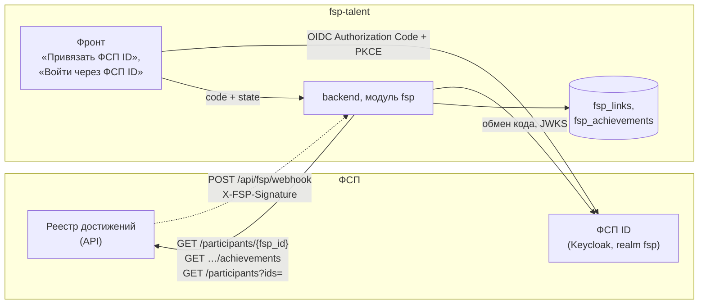
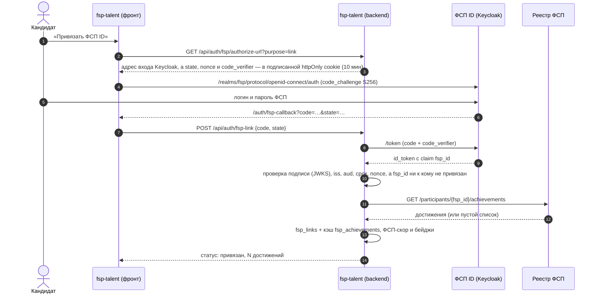
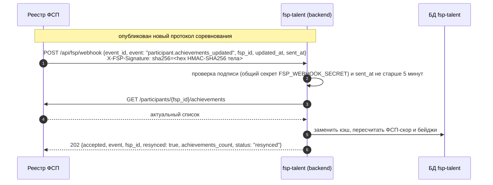

# 5. Схема интеграции с реестром ФСП

Организаторы намеренно не дали ни API, ни структуру данных ФСП [ТЗ 2, 4]. Поэтому мы сами
решили, какие сведения о достижениях получать и как показывать работодателю, и сделали
**работающую модель интеграции**: обе части ФСП подняты у нас локально и подключены к
платформе по тем же протоколам, что будут в реальности. Подробный черновик для ФСП —
[`docs/integration/fsp.md`](../integration/fsp.md); код — `backend/app/fsp/`,
мок реестра — `services/fsp-registry-mock/`, realm Keycloak — `infra/keycloak/realm-fsp.json`.

| Часть | В реальности | На хакатоне |
|---|---|---|
| ФСП ID (вход и подтверждение личности) | Keycloak ФСП | Keycloak 25, realm `fsp`, клиент `fsp-talent` (public, PKCE), claim `fsp_id` |
| Реестр достижений | API реестра ФСП (его пока нет) | `fsp-registry-mock` — это и есть наше предложение контракта API |
| Платформа | — | модуль `fsp`, таблицы `fsp_links` (связь профиля с ФСП ID) и `fsp_achievements` (кэш) |



## 5.1. Какие данные получаем и зачем

Работодателю важно не «участвовал ли человек», а **что это говорит о навыках**:

- **дисциплина** — продуктовое, алгоритмическое программирование, программирование систем ИБ,
  беспилотных авиационных систем, робототехники: к какой работе близок опыт;
- **уровень** — региональный, всероссийский, международный;
- **результат** — место, диплом I/II/III степени или участие; плюс размер зачёта
  («12 место из 300» и «12 место из 15» — разные вещи);
- **дата** — свежий результат весит больше старого;
- **командное или личное** участие и **роль в команде** (бэкенд, ML, капитан);
- **ссылка на протокол** — проверить результат в первоисточнике;
- **рейтинг-очки** реестра, если у ФСП есть свой рейтинг.

**Не берём:** дату рождения, контакты, документы, школу и вуз — для подбора не нужны
(минимизация данных, 152-ФЗ). ФИО и регион — только для сверки с профилем; работодателю до
принятия приглашения не показываются.

## 5.2. Вход и привязка через ФСП ID (OIDC)

Основной вход — свой (почта + пароль). ФСП ID нужен для «Привязать ФСП ID» (настройки
кандидата) и «Войти через ФСП ID» (только для уже привязанного профиля). Протокол — OpenID
Connect, Authorization Code + PKCE (S256); клиент публичный, поэтому PKCE обязателен.
Номер участника приходит в токене отдельным claim `fsp_id`.



| Правило | Ответ API |
|---|---|
| ФСП ID уже привязан к другому профилю | `409 fsp_id_taken` |
| к профилю уже привязан другой ФСП ID | `409 fsp_already_linked` |
| state истёк или подменён, код не принят, ID-токен не прошёл проверку | `400 oidc_error` (причина в `details.reason`) |
| вход через ФСП ID, а профиль не привязан | `404 fsp_account_not_linked` — предлагаем войти по почте и привязать |
| Keycloak недоступен | `503 keycloak_unavailable`; вход по почте работает как обычно |
| реестр недоступен при привязке | привязка сохраняется, достижения подтянутся по кнопке «Обновить» |
| отвязка (`DELETE /api/auth/fsp-link`) | связь и кэш удаляются, ФСП-скор — «нет данных» |

## 5.3. Контракт API реестра (наш мок)

Сервис `services/fsp-registry-mock`, Swagger — `http://localhost:18100/docs`.

| Метод | Что отдаёт |
|---|---|
| `GET /health` | `{"status": "ok", "participants": 40, "synthetic": true}` |
| `GET /participants/{fsp_id}` | ФИО, регион, дата регистрации в ФСП, `has_history`, сводка |
| `GET /participants/{fsp_id}/achievements` | `{fsp_id, has_history, total, items[], updated_at}`; фильтры `discipline`, `level` |
| `GET /participants?ids=FSP-000001,FSP-000002` | пакетно до 100 ID: `{items[], not_found[]}` — для ночной синхронизации |
| `GET /dictionaries` | дисциплины (`product`, `algorithmic`, `security`, `uav`, `robotics`) и уровни (`regional`, `national`, `international`) |

Коды дисциплин реестра `security` и `uav` платформа при синхронизации переводит в свои
`cybersecurity` и `uas` (`DISCIPLINE_FROM_REGISTRY` в `backend/app/fsp/service.py`);
остальные коды совпадают.

Ошибки — в формате платформы `{"code", "message", "details"}`: `404 participant_not_found`,
`422 invalid_fsp_id`. **Участник без истории — не ошибка:** `200`, `has_history: false`,
`items: []`.

Пример достижения:

```json
{
  "id": "ACH-000001-05",
  "competition": {
    "id": "COMP-2025-05",
    "title": "Международный онлайн-хакатон по продуктовому программированию",
    "participants_total": 260,
    "protocol_url": "https://registry.fsp.example/protocols/COMP-2025-05.pdf"
  },
  "discipline": {"code": "product", "title": "Продуктовое программирование"},
  "level": {"code": "international", "title": "Международный"},
  "date": "2025-09-13",
  "result": {"kind": "place", "place": 1, "diploma_degree": null, "label": "1 место"},
  "participation": "team",
  "team": {"name": "Северные лисы", "size": 5, "role": "фулстек-разработчик", "is_captain": false},
  "rating_points": 400,
  "verified": true
}
```

Тестовые данные (синтетика): `FSP-000001`–`FSP-000030` — с достижениями (от 1 до 8),
`FSP-000031`–`FSP-000040` — без истории, остальные — 404.

**Доступ платформы к реестру.** В реальной интеграции — сервисный токен Keycloak по client
credentials (отдельный конфиденциальный клиент). У нас: переменная `FSP_REGISTRY_TOKEN`
на бэкенде и `FSP_MOCK_API_TOKEN` в моке — тогда все методы мока, кроме `/health`, требуют
`Authorization: Bearer <токен>` (по умолчанию выключено). Клиент реестра: таймаут 5 с,
2 повтора при сетевой ошибке или 5xx (`FSP_REGISTRY_TIMEOUT_SEC`, `FSP_REGISTRY_RETRIES`).

## 5.4. Обновление данных

Достижения меняются редко, поэтому платформа хранит **кэш** и обновляет его:

1. **При привязке** — сразу (кандидат видит бейджи через секунду).
2. **Кнопкой «Обновить»** у кандидата — `POST /api/fsp/sync`.
3. **Вебхуком от реестра** — реестр сам сообщает об изменении (наше предложение для ФСП;
   на платформе реализовано).
4. **Пакетно** — `GET /participants?ids=…` пачками по 100: перезапрашиваются только участники,
   у которых `updated_at` новее нашей синхронизации; `not_found` → связь помечается, бейджи
   скрываются. Функция есть в сервисе (`FspService.sync_many`); запуск по расписанию (раз в
   сутки) — шаг реальной интеграции.



Вебхук: тело подписывается HMAC-SHA256 общим секретом, заголовок
`X-FSP-Signature: sha256=<hex>` (допускается и просто `<hex>`). Ответы: `202` — принято
(для других событий и непривязанных ФСП ID — `status: "ignored"`); `401 invalid_signature`;
`401 webhook_expired` (sent_at старше 5 минут); `422 validation_error`;
`503 fsp_registry_unavailable` — повторите позже; `503 webhook_disabled` — секрет не задан.
Повтор события безопасен: синхронизация заменяет кэш участника целиком, дублей нет.

Если реестр недоступен — показываем кэш, ничего не удаляем. Поиск, ранжирование и PDF-профиль
работают на кэше.

## 5.5. Если истории ФСП нет

Обязательный случай по ТЗ. Все три ситуации обрабатываются одинаково мягко:

| Ситуация | Кандидат видит | Работодатель видит | Ранжирование |
|---|---|---|---|
| ФСП ID не привязан | «Привяжите ФСП ID — достижения подтянутся автоматически» | «Нет данных ФСП» (нейтрально) | фактор ФСП = 0, штрафа нет |
| привязан, истории нет (`has_history: false`) | «В реестре ФСП пока нет результатов» | «Нет данных ФСП» | то же |
| реестр недоступен | кэш | кэш | по кэшу |

**Отсутствие истории — не штраф.** Кандидат без ФСП получает 0 по фактору «Достижения ФСП»,
остальные пять факторов не меняются: его место в выдаче определяют тест, стек, зарплата,
формат и свежесть. В API ФСП-скор такого кандидата — `null` («нет данных»), а не 0.
Формулировка «нет данных», а не «нет достижений» — чтобы не выглядело как недостаток.
Демо: `candidate.nofsp@example.com` (Frontend · Junior, без истории ФСП) проходит весь путь.

## 5.6. Что показываем работодателю

До принятия приглашения профиль обезличен, но достижения ФСП видны — это и есть
«подтверждённый профиль»:

- бейджи с пометкой **«подтверждено ФСП»** (не больше одного на уровень): «Победитель
  международного соревнования», «Призёр всероссийского соревнования», «Капитан команды»,
  «Участник N соревнований ФСП»;
- результаты: дисциплина, уровень, результат («2 место из 120»), год, роль в команде;
- ФСП-скор 0–100 полоской в разбивке счёта и одна строка в «почему в подборке»
  («Подтверждено ФСП: призёр всероссийского соревнования по продуктовому программированию, 2026»);
- ссылка на протокол.

Не показываем до принятия: ФИО, регион, название команды (по нему легко найти человека),
точные даты (только год). Кандидат может скрыть блок ФСП в настройках приватности.

## 5.7. ФСП-скор

Одно число 0–100 для ранжирования (вес 0,15) и объяснения (`backend/app/fsp/scoring.py`):

```
S = Σ по достижениям  L(уровень) × R(результат) × F(возраст)
ФСП-скор = round(100 × (1 − e^(−S / 3)))
```

| Множитель | Значения |
|---|---|
| L — уровень | региональный 1; всероссийский 2; международный 3 |
| R — результат | 1 место 1,0; 2 место 0,85; 3 место 0,7; диплом I 0,8; диплом II 0,6; диплом III 0,45; 4–10 место 0,4; ниже 10-го 0,25; участие 0,1 |
| F — свежесть | 0,5^(возраст в годах / 2) — результат «стареет» вдвое за 2 года |

Сумма с насыщением: много слабых участий не обгоняют одну победу, десятая победа добавляет
меньше первой. Примеры на данных мока (на 06.10.2026): FSP-000001 (7 достижений, в т.ч.
1 место международного зачёта) — 86; FSP-000005 (лучшее — диплом III всероссийского) — 24;
FSP-000007 (43 место из 48 на региональном) — 5; FSP-000031 — «нет данных».

Развитие с ФСП: множитель релевантности дисциплины специализации (ИБ — для DevOps,
алгоритмическое — для Backend и Data/ML) и учёт роли в команде.

## 5.8. Безопасность и согласие

- Токен ФСП ID проверяется на бэкенде (подпись по JWKS realm, `iss`, `aud`, срок, `nonce`);
  `state` защищает от CSRF, PKCE — от перехвата кода.
- Из реестра храним только поля из 5.1. Отвязка удаляет связь и кэш.
- Вебхук — только с верной подписью и свежим `sent_at`.

## 5.9. Учебный стенд ФСП ID

Keycloak: локально `http://localhost:18180`, на стенде — `https://159-194-200-243.sslip.io/kc`,
realm `fsp`.

| Логин | ФСП ID | История |
|---|---|---|
| `fsp.user01` … `fsp.user05` | `FSP-000001` … `FSP-000005` | есть |
| `fsp.nohistory` | `FSP-000031` | нет |

Пароль тестовых участников: `Fsp-demo-2026` (учебный, не секрет). Клиент `fsp-talent-test`
(вход по паролю для автотестов) — только для учебного стенда, в реальной интеграции его быть
не должно.

## 5.10. Что нужно от ФСП для реальной интеграции

1. Зарегистрировать в Keycloak ФСП клиент `fsp-talent` (public, PKCE S256, redirect URI
   платформы) и mapper claim `fsp_id`.
2. Выдать конфиденциальный клиент для сервисного доступа к реестру (client credentials).
3. Реализовать в реестре методы из 5.3 (или сообщить свои — меняется только `app/fsp/registry.py`).
4. По желанию — вебхук `participant.achievements_updated` с HMAC-подписью и общим секретом.

Адреса и секреты — переменные окружения (`KEYCLOAK_*`, `FSP_REGISTRY_URL`, `FSP_REGISTRY_TOKEN`,
`FSP_WEBHOOK_SECRET`), код менять не нужно.
