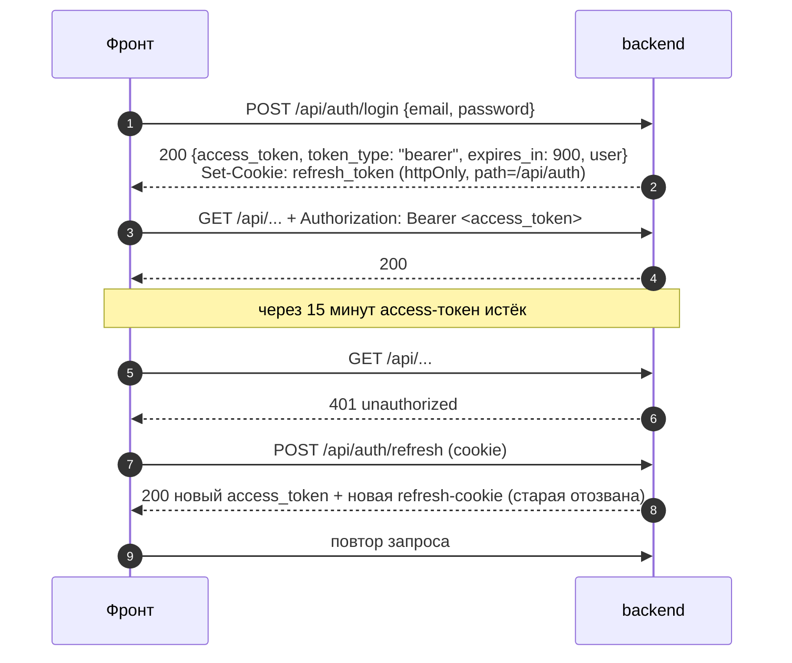

# 6. Описание API

## 6.1. Где смотреть

| Что | Где |
|---|---|
| Swagger UI (можно вызывать методы) | `/api/docs` — на стенде https://159-194-200-243.sslip.io/api/docs, локально http://localhost:18000/api/docs |
| ReDoc | `/api/redoc` |
| Схема OpenAPI 3.1 (живая) | `/api/openapi.json` |
| Выгрузка схемы в репозитории | [`docs/api/openapi.json`](../api/openapi.json) |
| Таблица методов по ролям и каталог кодов ошибок | [приложение `api_endpoints.md`](api_endpoints.md) (генерируется скриптом) |

Схему генерирует сам FastAPI из кода: у каждого метода описаны параметры, модель запроса
и ответа с примерами и **все коды ошибок** с примерами тел. Выгрузка в файл —
`python scripts/export_openapi.py` (или `make openapi`); CI проверяет, что файл совпадает с
кодом (`export_openapi.py --check`). По этой же схеме фронтенд генерирует TS-типы
(`npm run gen:api`) — контракт один на обе стороны.

Таблица в приложении строится скриптом из `openapi.json` и кода роутеров:

```bash
python docs/solution/tools/gen_api_table.py           # обновить docs/solution/api_endpoints.md
python docs/solution/tools/gen_api_table.py --check   # проверить, что таблица актуальна
```

## 6.2. Общие правила

- Префикс всех методов — `/api`. Формат — JSON (загрузка резюме — `multipart/form-data`,
  PDF-профиль и CSV — файлы).
- Ключи JSON, коды справочников и коды ошибок — по-английски; тексты для людей — по-русски.
- Справочные коды фиксированы: специализации `backend`, `frontend`, `mobile`, `data_ml`, `qa`,
  `devops`; грейды `intern`, `junior`, `middle`, `senior`; категория — `"<spec>:<grade>"`;
  роли `candidate`, `recruiter`, `admin`; ФСП ID — `FSP-000001`.
- Зарплата всегда диапазоном `salary_from` / `salary_to` в рублях, «от» ≤ «до».
- Даты и время — ISO 8601.
- Списки банка кандидатов — с пагинацией `page`, `page_size`.

## 6.3. Группы методов

Всего 131 метод (на 09.10.2026; актуальное число — в приложении).

| Группа (тег) | Префикс | Для кого | Что внутри |
|---|---|---|---|
| `system` | `/api/health` | все | живость сервиса и БД, версия миграций |
| `auth` | `/api/auth` | все | регистрация, подтверждение почты, вход, refresh, выход, сброс пароля, `me`, вход и привязка через ФСП ID |
| `users` | `/api/users/me/consents` | вошедшие | согласия на обработку ПДн и публикацию профиля |
| `catalog` | `/api/catalog` | все | специализации, грейды, категории, темы, стек, причины отказа |
| `candidates` | `/api/candidates` | соискатель; рекрутер (банк) | свой профиль, резюме (PDF → поля), PDF-профиль, настройки приватности, грейд; банк кандидатов и обезличенный профиль для рекрутера |
| `companies` | `/api/companies/my`, `/api/companies/ats/export` | рекрутер; ATS компании по API-токену | профиль компании, рекрутеры, код приглашения, дашборд; API-токены и вебхуки ATS (администратор компании), выгрузка для ATS |
| `testing` | `/api/testing` | соискатель | опрос, сессии теста, ответы, результат, статус грейда и кулдауны |
| `fsp` | `/api/fsp` | соискатель; реестр ФСП | статус привязки, достижения, «Обновить», вебхук реестра |
| `matching` | `/api/matching/needs` | рекрутер | потребности, разбор свободного текста, рекомендованные категории, подборка со счётом |
| `invitations` | `/api/invitations` | соискатель, рекрутер | приглашения, квота, счётчики, рыночная подсказка, принять / отклонить / отозвать |
| `vacancies` | `/api/vacancies`, `/api/applications` | соискатель, рекрутер | вакансии, публикация, отклики и их статусы |
| `tasks` | `/api/tasks` | соискатель, рекрутер; админ (периодические работы) | регулярные задания, раздача, ответы, оценка 0–3, `jobs/run` |
| `admin` | `/api/admin`, `/api/reports` | админ (жалоба — соискатель) | дашборд, пользователи, компании, справочники и настройки, банк задач (метрики, утечки, калибровка), тесты из вакансий, жалобы, журнал |
| `eval` | `/api/eval` | все (данные синтетические) | графики валидации, проверка подбора по CSV |

## 6.4. Авторизация



| Шаг | Метод | Детали |
|---|---|---|
| Регистрация | `POST /api/auth/register` | роль `candidate` или `recruiter` (рекрутер создаёт компанию или вступает по коду приглашения), почта, пароль, обязательное согласие на обработку ПДн → письмо со ссылкой (24 ч) |
| Подтверждение почты | `POST /api/auth/verify-email` | токен из письма; без подтверждения вход отвечает `403 email_not_verified`; повтор письма — `POST /api/auth/resend-verification` (не чаще раза в минуту) |
| Вход | `POST /api/auth/login` | access-токен JWT (HS256, 15 мин) в теле; refresh-токен — в httpOnly cookie `refresh_token` на пути `/api/auth` (30 дней, в БД — только хеш); 5 неудачных попыток за 15 минут на пару «почта + IP» → `429 too_many_attempts` |
| Запросы | любой защищённый метод | заголовок `Authorization: Bearer <access_token>`; без него — `401 unauthorized`, с чужой ролью — `403 forbidden`, заблокирован — `403 user_blocked` |
| Обновление | `POST /api/auth/refresh` | по cookie; refresh-токен ротируется — старый перестаёт действовать |
| Выход | `POST /api/auth/logout` | отзывает refresh-сессию и удаляет cookie |
| Сброс пароля | `POST /api/auth/password-reset/request`, `…/confirm` | письмо со ссылкой (60 мин); после смены пароля все refresh-сессии отзываются |
| ФСП ID | `GET /api/auth/fsp/authorize-url`, `POST /api/auth/fsp/login`, `POST/DELETE /api/auth/fsp-link` | OIDC + PKCE через Keycloak, см. [раздел 5](05_fsp_integration.md#52-вход-и-привязка-через-фсп-id-oidc) |

В Swagger: «Authorize» → схема `HTTPBearer` → вставить `access_token` из ответа `/api/auth/login`.

**Демо-заголовки (только dev).** При `DEMO_AUTH_ENABLED=true` вместо токена можно передать
`X-Demo-Role: candidate | recruiter | admin` и необязательно `X-Demo-User-Id: <id>` — удобно
для отладки и автотестов. На стенде (`infra/stand/compose.yml`) заглушка выключена
(`DEMO_AUTH_ENABLED=false`), работает только JWT.

**Вебхук реестра ФСП** (`POST /api/fsp/webhook`) аутентифицируется не токеном, а подписью
тела: `X-FSP-Signature: sha256=<hex HMAC-SHA256>` общим секретом `FSP_WEBHOOK_SECRET`.

**Выгрузка для ATS** (`GET /api/companies/ats/export`) — без входа пользователя, по API-токену
компании в заголовке `X-Api-Token` (в Swagger — схема `APIKeyHeader`). Токен выпускает
администратор компании (`POST /api/companies/my/api-tokens`), он показывается один раз.
**Исходящие вебхуки в ATS** платформа подписывает сама: `X-FSP-Signature: sha256=<hex
HMAC-SHA256(секрет вебхука, "<X-FSP-Timestamp>." + тело)>` (раздел 3.13).

## 6.5. Формат ошибок

Любая ошибка — одно и то же тело:

```json
{"code": "salary_below_expectations",
 "message": "Вилка ниже ожиданий кандидата. Поднимите верхнюю границу.",
 "details": {}}
```

| HTTP | Типовые `code` | Когда |
|---|---|---|
| 400 | `bad_request`, `token_invalid`, `oidc_error` | неверный запрос, ссылка из письма, ошибка входа через ФСП ID |
| 401 | `unauthorized`, `invalid_credentials`, `invalid_refresh_token`, `invalid_signature` | нет или неверный токен, пароль, подпись |
| 403 | `forbidden`, `user_blocked`, `email_not_verified`, `company_blocked`, `no_contact_with_company` | чужая роль, блокировка пользователя или компании, неподтверждённая почта, жалоба без контакта с компанией |
| 404 | `not_found` (`details.resource`, `details.id`) | объекта нет **или он чужой** — чужие приглашения, отклики, потребности не раскрываются даже фактом существования |
| 409 | `invalid_transition`, `quota_exceeded`, `already_invited`, `already_applied`, `cooldown_active`, `fsp_id_taken`, `email_taken`, `report_exists`, … | конфликт с состоянием (статус, квота, кулдаун, уже существует) |
| 410 | `token_expired` | ссылка из письма истекла |
| 413 / 415 | `file_too_large`, `unsupported_file` | PDF-резюме больше 5 МБ или не PDF |
| 422 | `validation_error` (`details.errors` — список полей), `salary_below_expectations`, `unknown_skills`, … | ошибка данных; для «от» > «до» в `details.errors` — `salary_range_invalid` |
| 429 | `too_many_attempts`, `too_many_requests` | лимит попыток входа, частые письма |
| 503 | `keycloak_unavailable`, `fsp_registry_unavailable`, `webhook_disabled` | внешний сервис недоступен (основная работа не страдает) |

Полный каталог кодов с сообщениями и числом методов — в [приложении](api_endpoints.md#коды-ошибок).

## 6.6. Примеры

Вход и подборка (стенд или локально, демо-учётка рекрутера):

```bash
API=http://localhost:18000/api          # или https://159-194-200-243.sslip.io/api
TOKEN=$(curl -s -H 'Content-Type: application/json' \
  -d '{"email":"recruiter@example.com","password":"demo1234"}' \
  $API/auth/login | python -c "import sys,json;print(json.load(sys.stdin)['access_token'])")

curl -s -H "Authorization: Bearer $TOKEN" $API/matching/needs
curl -s -H "Authorization: Bearer $TOKEN" "$API/matching/needs/2/candidates"
curl -s -H "Authorization: Bearer $TOKEN" \
  "$API/invitations/market-hint?category=backend:senior&salary_from=300000&salary_to=400000"
```

Без токена — `401 {"code":"unauthorized","message":"Требуется вход","details":{}}`;
рекрутер на методе админа — `403 {"code":"forbidden","message":"Недостаточно прав",
"details":{"required_roles":["admin"],"role":"recruiter"}}`.

## 6.7. API мока реестра ФСП

Отдельный сервис со своим Swagger (`http://localhost:18100/docs`): `GET /health`,
`GET /participants/{fsp_id}`, `GET /participants/{fsp_id}/achievements`,
`GET /participants?ids=…`, `GET /dictionaries` — см. [раздел 5.3](05_fsp_integration.md#53-контракт-api-реестра-наш-мок).
