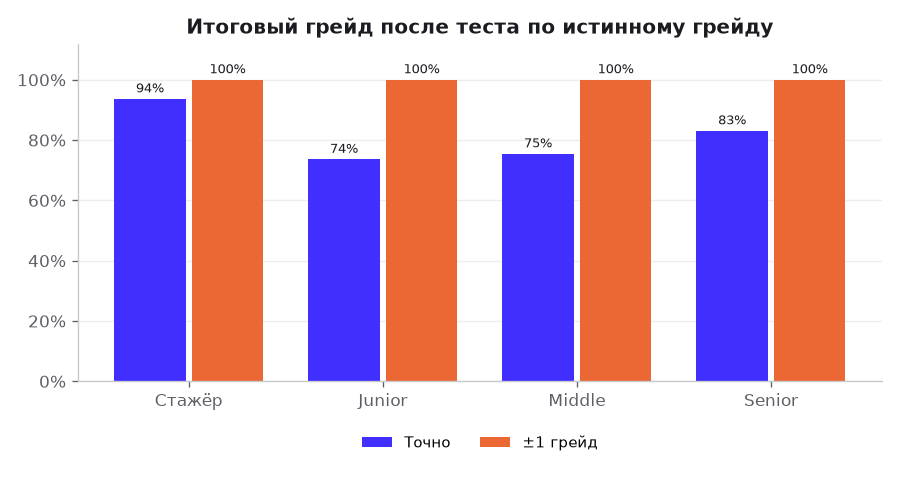
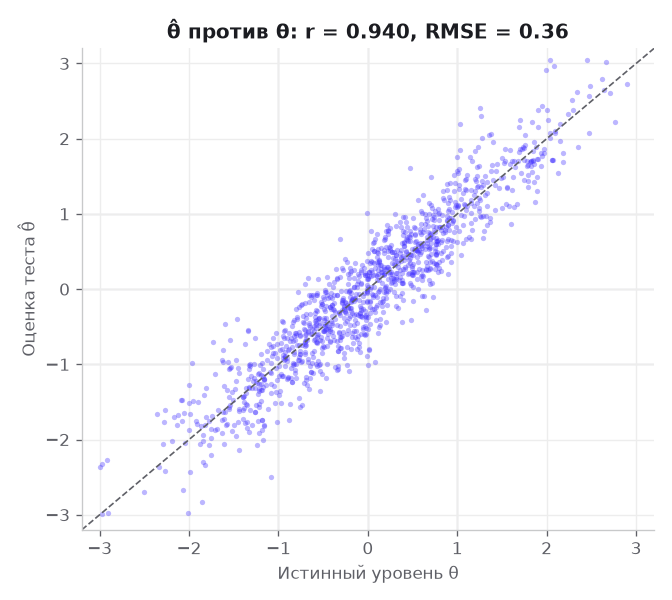
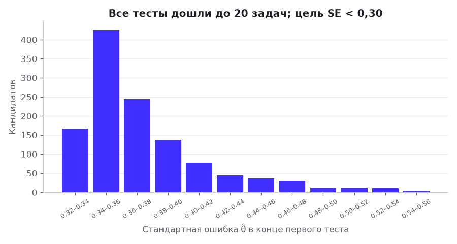
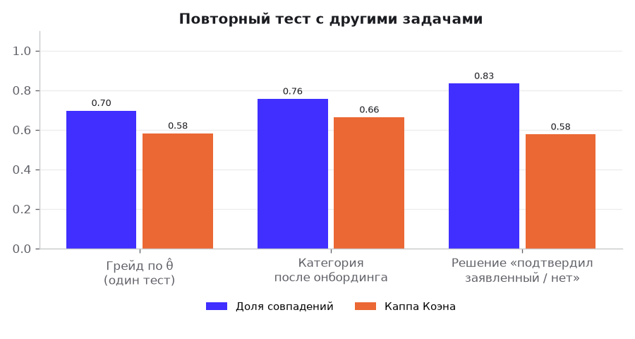
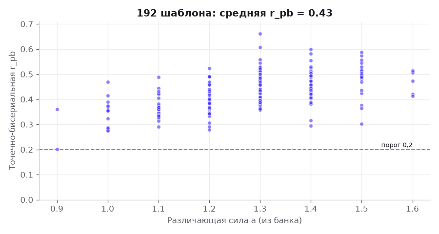
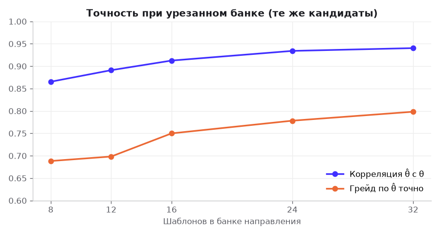
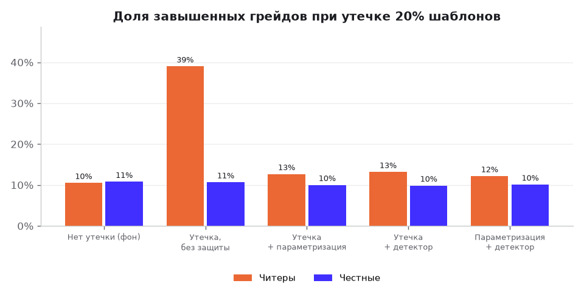
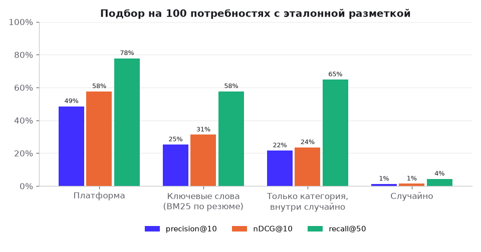
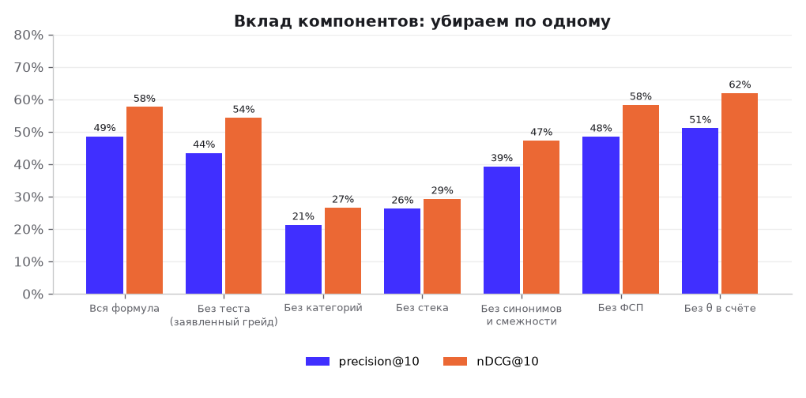

# Валидация решения: процедура и результаты

Готовых датасетов и эталонной разметки в хакатоне нет [ТЗ 2], поэтому мы проверяем решение на **синтетических данных с известной правдой**: у каждого кандидата заранее задан истинный уровень и реальный стек, но платформа их не видит — она видит только резюме, заявленный грейд и ответы в тесте. Так можно честно посчитать, насколько тест угадывает уровень и насколько подбор находит подходящих.

Всё воспроизводится одной командой с фиксированным seed 20261011 (раздел «Воспроизведение»). Цифры в этом файле и на экране «Валидация» в админке берутся из одного прогона (`data/validation/results.json`, прогон 2026-10-07).

## Главное

| Что проверяем | Критерий ТЗ | Результат |
|---|---|---|
| Доля подходящих в топ-10 выдачи (precision@10) | 6.1 | **48,6%** против 25,3% у поиска по ключевым словам и 1,3% у случайного |
| nDCG@10 (подходящие выше — лучше) | 6.1 | **0,577** против 0,313 у ключевых слов |
| Найдено подходящих в первых 50 (recall@50) | 6.1 | **77,8%** против 57,7% |
| Потребностей, где платформа лучше ключевых слов (nDCG@10) | 6.1 | 87 из 100 |
| Тест восстанавливает уровень (корреляция θ̂ с истинным θ) | 6.2 | **0,940**, RMSE 0,36 |
| Итоговый грейд совпал с истинным: точно / ±1 | 6.2 | **78,8%** / 100,0% (по заявленному грейду было бы 64,9%) |
| Повтор теста — та же категория (каппа Коэна) | 6.2 | 75,6% (κ = 0,66) |
| Различающая сила задач (средняя точечно-бисериальная) | 6.2 | 0,43; выше 0,2 — 100% шаблонов |
| Утечка 20% задач: читерам завышен грейд, без защиты → с параметризацией | 6.2 | 39,0% → **12,7%** (фон у честных 10,7%) |
| Детектор утечек: полнота / точность | 6.2 | 100% / 95% |

Слабые места мы тоже показываем: тест на текущем банке (32 шаблона на направление) не набирает цель SE < 0,30 за 20 задач, повтор даёт ту же категорию в 76% случаев, а θ внутри категории не улучшает соответствие нашей разметке (раздел 6.3).

## 1. Что и как проверяем

| Критерий ТЗ | Как измеряем | Раздел |
|---|---|---|
| 6.1 «доля релевантных кандидатов в топе выдачи на тестовом наборе пар» | precision@10, nDCG@10, recall@50 на 100 потребностях с эталонной разметкой; сравнение с поиском по ключевым словам резюме и со случайным порядком; доверительные интервалы | 6 |
| 6.1 «обоснованность ранжирования» | абляция: убираем по одному компоненту формулы | 6.3 |
| 6.2 «соответствие эталонной разметке» | θ̂ против истинного θ, грейд против истинного | 4.2 |
| 6.2 «согласованность (стабильный грейд при повторе)» | повтор онбординга с другими задачами: доля совпадений, каппа Коэна | 4.3 |
| 6.2 «дискриминативность заданий» | точечно-бисериальная корреляция каждого из 192 шаблонов | 4.4 |
| 6.2 «устойчивость к распространению заданий» | симуляция утечки 20% банка | 5 |
| 6.2 «корректность категоризации» | итоговая категория против истинной по направлениям и грейдам | 4.2 |
| Проверка жюри своим набором пар | `POST /api/eval/matching` + экран «Валидация» | 7 |

Важно: всё считает **настоящий код платформы**, а не его копия: адаптивный тест — `CATSession` и `decide` из `backend/app/testing/engine`, банк — `bank_registry()` (192 шаблонов с их a и b), выдача — `score_candidate` и правила категорий подбора (`backend/app/matching`), стек — справочник синонимов `normalize_skill`, ФСП-скор — `app.fsp.scoring.fsp_score`.

## 2. Синтетические данные

**1200 кандидатов** (`data/validation/candidates.json`). Для каждого:

| Скрыто от платформы (правда) | Видит платформа |
|---|---|
| истинный уровень θ ~ N(0, 1) и истинный грейд по порогам −1 / 0 / 1 | заявленный грейд: 60% честно, 25% на ступень выше, 15% ниже |
| технологии, которыми реально владеет: кластер стека направления (Python+Django+PostgreSQL, Java+Spring, Go+gRPC, React+TypeScript, Kotlin+Android SDK…), у старших шире | резюме: 15% технологий забыты; 45% написаны сленгом и синонимами («постгрес», «k8s», «питон»); у 20% резюме дописаны 2–4 технологии «для ключевых слов» (чаще у тех, кто завышает грейд) |
| — | ответы в тесте: верно с вероятностью 2PL от истинного θ |
| ФСП-история коррелирует с уровнем (сильнее — больше призов) | ФСП-скор по формуле платформы; у 40% истории нет |
| — | минимальная зарплата (от заявленного грейда и направления, разброс ±18%), форматы работы, свежесть профиля (у 45% нулевая), опыт |

**100 потребностей** (`data/validation/needs.json`): направление, грейд, 1–3 обязательных и 0–2 желательных технологии из одного кластера, вилка по рынку грейда, формат. Потребность оставляем, если в базе есть хотя бы 3 подходящих кандидата (сгенерировано 101, оставлено 100). В среднем на потребность 16,2 подходящих (от 3 до 63) и 3,3 подходящих частично.

## 3. Правило эталонной разметки

Эталон (`data/validation/gold.csv`) строится **только по скрытой правде** (`scripts/validation/synth.py`, функция `relevance`):

- **0 — не подходит**, если нарушено хоть одно: истинное направление кандидата совпадает с направлением потребности; кандидат *реально* владеет всеми обязательными технологиями (истинный стек, а не резюме); минимальная зарплата кандидата ≤ «до» вилки;
- иначе **2 — подходит**, если истинный грейд равен грейду потребности, **1 — подходит частично**, если истинный грейд на ступень выше (справится, но переквалифицирован), и 0 в остальных случаях.

«Релевантен» в precision и recall — оценка 2; nDCG учитывает обе оценки (выигрыш 2^оценка − 1).

**Чем эталон отличается от формулы ранжирования** — иначе метрика была бы бессмысленной:

| Признак | Эталон | Формула платформы |
|---|---|---|
| Уровень | истинный грейд | категория и θ̂ из теста (с ошибкой измерения) |
| Стек | истинные навыки, все обязательные — жёстко | резюме (с пропусками, сленгом и приписками), доля совпадения 0..1, синонимы и смежные технологии дают частичный вклад |
| Желательный стек | не учитывается | 25% стековой части |
| ФСП, свежесть профиля, формат работы | не учитываются | входят в счёт |
| Зарплата | жёсткий фильтр «минимум ≤ до» | 1 / 0,7 / 0 по положению в вилке |

Общая только зарплата: это объективное условие, и платформа не даёт отправить приглашение ниже минимума кандидата.

## 4. Тест

### 4.1 Процедура

Каждый кандидат проходит настоящий адаптивный тест по банку своего направления (32 шаблона) с настройками стенда: до 20 задач, остановка при SE < 0,30 (не раньше 6 задач), выбор случайной задачи из топ-5 по информации, баланс тем; лимит экспозиции выключен, пока в направлении меньше 100 шаблонов (как на стенде). Онбординг повторяет правила платформы: тест на заявленный грейд; не прошёл — тест на грейд ниже (и так до прохождения, грейд принудительно не понижается); прошёл уверенно — один тест на грейд выше. В среднем 1,34 теста на кандидата.

### 4.2 Точность и категоризация





| Метрика | Значение |
|---|---|
| Корреляция θ̂ первого теста с истинным θ | 0,940 |
| RMSE θ̂ | 0,358 |
| Средняя SE в конце теста | 0,374 |
| Грейд по θ̂ одного теста: точно / ±1 | 80,2% / 99,8% |
| То же, если истинный θ дальше 0,25 от порога | 87,3% |
| **Итоговая категория после онбординга: точно / ±1** | **78,8%** / 100,0% |
| Итоговая категория, θ дальше 0,25 от порога (57% кандидатов) | 84,5% |
| Для сравнения: заявленный грейд совпадает с истинным | 64,9% |
| Завысили грейд при регистрации (281 чел.): получили истинный / остались выше | 74,4% / 15,3% |
| Средняя длина теста / доля остановленных по SE | 20,0 / 0,0% |

| Истинный грейд | Кандидатов | Категория точно | ±1 | Грейд по θ̂ одного теста |
|---|---|---|---|---|
| Стажёр | 189 | 93,7% | 100,0% | 83,6% |
| Junior | 413 | 73,6% | 100,0% | 76,5% |
| Middle | 415 | 75,4% | 100,0% | 78,8% |
| Senior | 183 | 83,1% | 100,0% | 88,0% |

| Направление | Кандидатов | Категория точно |
|---|---|---|
| Backend | 286 | 76,6% |
| Frontend | 249 | 78,7% |
| Mobile | 145 | 78,6% |
| Data Science / ML | 182 | 80,8% |
| QA | 169 | 75,7% |
| DevOps | 169 | 84,0% |

Как читать: тест почти никогда не ошибается больше чем на один грейд; промахи — у кандидатов рядом с порогом двух грейдов (вдали от порога точность заметно выше). Тест исправляет заявленный грейд: из тех, кто завысил себе уровень, большинство получают истинный.



Все тесты идут до 20 задач: на банке из 32 шаблонов цель SE < 0,30 недостижима, средняя итоговая SE 0,37. Это ограничение банка, а не движка: см. 4.5.

### 4.3 Стабильность при повторе



Те же кандидаты проходят весь онбординг второй раз — с другими задачами и вариантами.

| Что сравниваем | Доля совпадений | Каппа Коэна |
|---|---|---|
| Итоговая категория | 75,6% | 0,663 |
| Грейд по θ̂ первого теста | 69,7% | 0,582 |
| Решение «заявленный грейд подтверждён / нет» | 83,3% | 0,576 |
| Корреляция θ̂ первого и второго теста | 0,889 | |

Каппа для категории 0,66 — «существенное согласие» по шкале Лэндиса — Коха; случайное совпадение дало бы около 0. Расхождения — у кандидатов на границе грейдов: одна-две задачи переводят их через порог. Повторный тест и так ограничен правилами (не чаще раза в 30/90 дней), поэтому «перебросить кубик» нельзя.

### 4.4 Различающая сила задач



Классический анализ задач: каждый синтетический кандидат решает **все** шаблоны своего направления; для шаблона считаем точечно-бисериальную корреляцию ответа с суммой баллов по остальным задачам. Выше 0,2 — задача отделяет сильных от слабых.

| Метрика | Значение |
|---|---|
| Средняя r_pb (все 192 шаблонов) | 0,430 |
| Доля шаблонов с r_pb > 0,2 | 100,0% |
| Минимальная r_pb | 0,201 |
| Средняя различающая сила a банка | 1,28 |
| r_pb в адаптивном тесте (средняя / доля > 0,2, 190 шаблонов) | 0,374 / 91,6% |

В адаптивном тесте r_pb ниже — так и должно быть: задачи подбираются под уровень, разброс отвечающих по каждой задаче мал.

Ограничение: ответы генерируются по тем же a, b, что лежат в банке, поэтому этот анализ проверяет, что параметры банка дают различающие задачи, а не сами параметры. Настоящие a, b пересчитываются по ответам (кнопка «Пересчитать калибровку» в админке).

### 4.5 Устойчивость к ошибке калибровки и размер банка

Экспертные a, b неточны. Прогон, где истинные параметры отличаются от экспертных (b ± 0,3, a × e^(±0,3)), а движок знает только экспертные: корреляция 0,941 (было 0,940), грейд точно 78,4% (было 80,2%).



| Шаблонов в банке направления | Корреляция θ | Средняя SE | Грейд по θ̂ точно | Длина теста |
|---|---|---|---|---|
| 8 | 0,865 | 0,592 | 68,8% | 8,0 |
| 12 | 0,891 | 0,513 | 69,8% | 12,0 |
| 16 | 0,913 | 0,459 | 75,0% | 16,0 |
| 24 | 0,934 | 0,400 | 77,8% | 20,0 |
| 32 | 0,940 | 0,374 | 79,8% | 20,0 |

Рост точности на 32 шаблонах ещё не остановился, и до 20 задач тест показывает больше половины банка. Синтетическая симуляция движка (`docs/testing/engine.md`, раздел 9) показывает, что при 120+ шаблонах на направление тест набирает SE ≈ 0,35 за 12–13 задач и включается лимит экспозиции. Расширение банка — главный путь к стабильности повтора.

## 5. Утечка заданий



Поток из 1000 тестов на каждое направление (6000 всего). Сначала честный прогон; по нему сливаются 36 из 192 шаблонов (20%) — с вероятностью, пропорциональной числу показов (утечь может то, что видели). 10% кандидатов — читеры (600): на слитой задаче отвечают верно и быстро. С параметризацией слитый ответ подходит, только если читеру попался тот же вариант (консервативно 10%; у шаблона от 50 вариантов). Детектор (`detect_leaks`, настройки по умолчанию) запускается каждые 10 сессий направления (на стенде — после каждой 50-й сессии по всем направлениям) и выводит помеченные шаблоны из оборота.

| Режим | Читерам завышен грейд | Честным завышен | θ̂ − θ у читеров | Детектор задач: найдено слитых / ложных | Выведено по ходу | Детектор кандидатов: точность / полнота |
|---|---|---|---|---|---|---|
| Нет утечки (фон) | 10,5% | 10,8% | 0,00 | — / 1 | 0 | 12% / 0% |
| Утечка, без защиты | 39,0% | 10,7% | 0,44 | 100% / 0 | 0 | 99% / 71% |
| Утечка + параметризация | 12,7% | 10,0% | 0,05 | 0% / 1 | 0 | 71% / 4% |
| Утечка + детектор | 13,2% | 9,8% | 0,07 | 100% / 2 | 38 | 81% / 6% |
| Параметризация + детектор | 12,2% | 10,1% | 0,05 | 3% / 4 | 5 | 73% / 4% |

- Без защиты утечка 20% банка завышает грейд 39% читеров (фон ошибки измерения у честных — 11%).
- Параметризация возвращает картину почти к фону: 13%. Это главная защита: слитый ответ к чужому варианту не подходит.
- Если шаблон всё же один на всех, детектор находит 100% слитых (сигнал скорости 100%, IRT-сигнал 6%) и снижает завышение до 13%; ложных срабатываний — 2 шаблона из 156 честных. Детектор кандидатов без параметризации находит 71% читеров с точностью 99% — это повод для ручной проверки, а не наказание.
- Цена: в фоне без утечки детектор ошибочно помечает 1 шаблон, а в режиме «параметризация + детектор» — 4: шаблон уходит из оборота до проверки админом. Это осознанный выбор «лучше вывести лишнее, чем пропустить утечку»; порог настраивается.

## 6. Подбор

### 6.1 Процедура

Для каждой из 100 потребностей платформа строит выдачу так, как её видит рекрутер (`backend/app/eval/ranking.py::system_order`): сначала кандидаты основной категории потребности (категория — из теста), затем рекомендованные соседние категории (грейд ±1, смежное направление), затем остальные; внутри — по счёту `score_candidate` с весами платформы (стек 0,3, θ 0,25, ФСП 0,15, свежесть 0,1, зарплата 0,1, формат 0,1). Стек кандидата — из резюме через справочник синонимов (как разбор резюме).

Базовые линии:

- **Ключевые слова резюме** — BM25 по тексту резюме по всей базе; запрос — грейд, направление и названия технологий потребности (так ищут на обычной джоб-площадке);
- **Случайно** — случайный порядок всей базы (среднее 20 перестановок);
- **Только категория** — кандидаты категории из теста сверху, внутри — случайно (показывает, сколько даёт сама категоризация без формулы счёта).

Метрики — по каждой потребности, затем среднее; в скобках 95% бутстреп-интервал по потребностям.

### 6.2 Результаты



| Способ | precision@10 | мягкая precision@10 (оценка ≥ 1) | nDCG@10 | recall@50 |
|---|---|---|---|---|
| **Платформа** | 0,486 (0,44–0,53) | 0,560 | 0,577 (0,54–0,62) | 0,778 (0,75–0,81) |
| Ключевые слова (BM25) | 0,253 (0,23–0,28) | 0,294 | 0,313 (0,28–0,34) | 0,577 (0,54–0,62) |
| Только категория, внутри случайно | 0,216 (0,19–0,25) | 0,237 | 0,236 (0,21–0,27) | 0,649 (0,61–0,69) |
| Случайно | 0,013 (0,01–0,02) | 0,016 | 0,014 (0,01–0,02) | 0,044 (0,04–0,05) |

Платформа ставит в топ-10 в среднем 4,9 подходящих кандидатов из 10, поиск по ключевым словам — 2,5, случайный выбор — 0,13. Интервалы не пересекаются. По nDCG@10 платформа лучше ключевых слов в 87 потребностях из 100, хуже — в 13. Доля всех подходящих, попавших в топ-10: 29,9% у платформы и 15,6% у ключевых слов (у многих потребностей подходящих больше 10, поэтому 100% здесь недостижимо).

| Направление | Потребностей | precision@10 платформы | ключевых слов | nDCG@10 платформы | ключевых слов |
|---|---|---|---|---|---|
| Backend | 27 | 0,452 | 0,248 | 0,565 | 0,289 |
| Frontend | 26 | 0,496 | 0,238 | 0,523 | 0,296 |
| Mobile | 9 | 0,500 | 0,244 | 0,649 | 0,366 |
| Data Science / ML | 14 | 0,521 | 0,314 | 0,596 | 0,353 |
| QA | 15 | 0,447 | 0,267 | 0,550 | 0,303 |
| DevOps | 9 | 0,556 | 0,200 | 0,705 | 0,330 |

**Устойчивость выдачи.** Если все кандидаты пройдут тест заново, топ-10 потребности совпадает в среднем на 62% (минимум 10%): меняются кандидаты на границе категорий. При одних и тех же данных выдача детерминирована.

### 6.3 Вклад компонентов (абляция)



| Вариант | precision@10 | nDCG@10 | recall@50 |
|---|---|---|---|
| Вся формула | 0,486 | 0,577 | 0,778 |
| Без теста: категория по заявленному грейду, θ нет | 0,435 | 0,543 | 0,782 |
| Без категорий: только счёт по всей базе | 0,213 | 0,266 | 0,527 |
| Без стека (вес 0) | 0,263 | 0,293 | 0,708 |
| Без синонимов и смежности технологий (точное написание) | 0,393 | 0,473 | 0,732 |
| Без ФСП (вес 0) | 0,485 | 0,583 | 0,776 |
| Без θ в счёте (вес 0; категория из теста остаётся) | 0,511 | 0,620 | 0,775 |

Чувствительность к весу θ (остальные веса пропорционально):

| Вес θ | precision@10 | nDCG@10 |
|---|---|---|
| 0,00 | 0,511 | 0,620 |
| 0,10 | 0,502 | 0,608 |
| 0,25 | 0,486 | 0,577 |
| 0,40 | 0,449 | 0,532 |

- **Тест и категории — главный вклад.** Без категорий precision@10 падает до 0,213; с категорией по заявленному грейду вместо теста — до 0,435: тест исправляет завышенные грейды, и в выдачу не попадают те, кто не дотягивает.
- **Стек и справочник синонимов.** Без стека — 0,263; без синонимов и смежности (только точное написание) — 0,393: «постгрес» и «k8s» в резюме иначе теряются. Именно здесь проигрывает поиск по ключевым словам.
- **ФСП** почти не меняет метрики (0,485): наша разметка его не учитывает. ФСП в счёте — требование ТЗ («выше те, у кого есть опыт соревнований») и сигнал для рекрутера, а не способ угадать эталон; важно, что он не ухудшает выдачу.
- **θ внутри категории** немного *ухудшает* соответствие разметке (0,511 без θ против 0,486): внутри категории θ поднимает самых сильных, а среди них чаще переквалифицированные — их истинный грейд на ступень выше, и эталон считает их подходящими лишь частично. Это расхождение между ТЗ («выше — сильнее подтверждённый профиль») и строгой разметкой «точно этот грейд». Вывод для продукта: θ стоит оставить в счёте (этого требует ТЗ), но с меньшим весом: при 0,1 precision@10 0,502 вместо 0,486; веса настраиваются в админке без изменения кода.

## 7. Проверка жюри своим набором пар

Экран «Валидация» в админке и `POST /api/eval/matching` (Swagger: `/api/docs`) принимают CSV пар «потребность — кандидат» и возвращают метрики. **Порядок строк не важен — кандидатов каждой потребности ранжирует сама платформа**, а метрики показывают, сколько подходящих оказалось наверху.

Формат (UTF-8, разделитель `,` или `;`):

```csv
need_id,candidate_id,relevant
N004,C0123,1
N004,C0456,0
```

- `need_id` — потребность: синтетическая (`N001`…`N100`) или созданная на стенде (число);
- `candidate_id` — кандидат: синтетический (`C0001`…) или профиль на стенде (число);
- `relevant` — 1 подходит, 0 нет (или 0/1/2 с «частично»). Без колонки для синтетики берётся наш эталон, для стенда — совпадение категории кандидата с категорией потребности.

Если id не найдены ни там, ни там, оценивается порядок строк файла как готовая выдача.

Пример — `data/validation/example_pairs.csv`: 6 потребностей (по одной на направление) × 40 кандидатов, выбранных независимо от выдачи платформы: до 10 подходящих, до 5 частично подходящих, остальные неподходящие (своего и других направлений); строки перемешаны. Ответ эндпоинта: precision@10 {num(ex['precision_at_10'])}, nDCG@10 {num(ex['ndcg_at_10'])}, у поиска по словам 0,617 / 0,679, при случайном порядке 0,250.

```bash
curl -F file=@data/validation/example_pairs.csv http://localhost:18000/api/eval/matching
```

Чтобы проверить на своих данных стенда: создать потребность в кабинете рекрутера, разметить кандидатов (id профилей видны в API подборки) и загрузить CSV.

## 8. Ограничения (честно)

- **Синтетика — не рынок.** Распределения уровней, стека, зарплат и поведения (завышение грейда, приписки в резюме) — наши допущения. Они правдоподобны, но не измерены. Процедура переносится на реальные данные без изменений: нужна экспертная разметка пар (их можно загрузить через `/api/eval/matching` в режиме стенда).
- **Ответы в тесте по модели 2PL с параметрами банка.** Реальные кандидаты отвечают не строго по модели; устойчивость к ошибке параметров проверена (раздел 4.5), но не к другой форме кривой ответа. Время ответа в сценарии утечки — тоже модель (быстрые честные ответы редки).
- **Эталон написан нами.** Правило разметки специально не совпадает с формулой (раздел 3), но выбор признаков эталона — тоже наше решение. Например, мы не считаем ФСП признаком соответствия.
- **Направление кандидата считаем известным** (его даёт опрос при регистрации); ошибки опроса не моделируются.
- **Банк из 32 шаблонов на направление** ограничивает точность и стабильность теста (раздел 4.5).
- **Отбор потребностей:** оставлены только те, под которые в базе есть ≥ 3 подходящих.

## 9. Воспроизведение

Из корня репозитория (нужны зависимости бэкенда и matplotlib; БД не нужна):

```bash
pip install -e "backend[dev]" matplotlib
python scripts/validation/run_all.py
```

Скрипт (~3–4 минуты, направления в сценарии утечки считаются параллельно) перезаписывает `data/validation/*`, `docs/validation/img/*.png` и этот файл. Seed фиксирован (20261011): повтор даёт те же цифры. Метрики покрыты тестами `backend/tests/test_eval_metrics.py`, эндпоинты — `backend/tests/test_eval_api.py`.

Код: `scripts/validation/` (synth — данные и эталон, testing_sim — тест и утечка, matching_sim — подбор, charts — графики, report — этот текст), `backend/app/eval/` (метрики, выдача, API).

## 10. Другие проверки

- Механика теста и синтетическая симуляция движка на большом банке — `docs/testing/engine.md`.
- Разбор PDF-резюме — `docs/validation/resume_parsing.md`.
- Разбор свободного текста потребности — `docs/validation/need_parsing.md`.
- Тест из текста вакансии — `docs/validation/vacancy_tests.md`.
